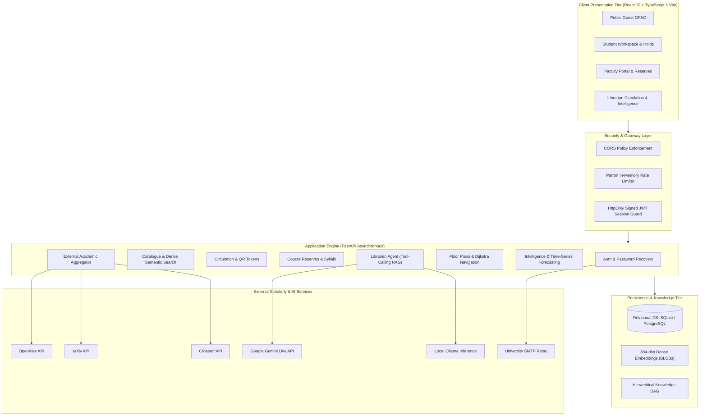

# ATHENAEUM
### AI-Powered Smart Library Management System

[](https://www.python.org/)
[](https://fastapi.tiangolo.com/)
[](https://react.dev/)
[](https://www.typescriptlang.org/)
[](https://vitejs.dev/)
[](https://www.sqlalchemy.org/)
[-success.svg)]()
[](./CSE_276_ATHENAEUM_AI_TECHNICAL_REPORT.pdf)
[]()

**Athenaeum** is an enterprise-grade academic library automation and intelligence platform. It bridges physical resource circulation—monograph barcode tracking, patron quotas, study-space bookings, and course reserves—with modern dense semantic discovery, multi-floor interactive spatial wayfinding, external scholarly aggregation, an autonomous multi-step tool-executing AI Copilot, and multimodal omnichannel research discovery across audio lecture clips, PDFs, slide decks, and diagrams.

---

## 📚 Table of Contents

- [1. Product Overview](#1-product-overview)
- [2. System Architecture](#2-system-architecture)
- [3. Key Capabilities](#3-key-capabilities)
- [4. The Five AI Pillars](#4-the-five-ai-pillars)
- [5. Technology Stack](#5-technology-stack)
- [6. Screenshots & Interface Gallery](#6-screenshots--interface-gallery)
- [7. Quick Start Guide](#7-quick-start-guide)
- [8. AI Provider Configuration & Key Policy](#8-ai-provider-configuration--key-policy)
- [9. Testing & Quality Assurance](#9-testing--quality-assurance)
- [10. Documentation Index](#10-documentation-index)
- [11. Project Status & Limitations](#11-project-status--limitations)
- [12. License & Governance](#12-license--governance)

---

## 1. Product Overview

University libraries operate at the intersection of physical spaces and digital knowledge. Traditional Integrated Library Systems (ILS) excel at recording inventory but fail to provide intuitive digital discovery, directional physical guidance, or transparent computational intelligence.

Athenaeum resolves these institutional challenges through three interconnected domains:

1. **For Students**: A unified workspace combining hybrid lexical and dense vector catalog search, self-service loan management, waitlist hold queuing, touchless cryptographic QR collection passes, study desk/room booking with live occupancy indicators, and a verifiable RAG-grounded AI Copilot.
2. **For Teachers & Faculty**: Extended academic borrowing privileges, course creation, syllabus upload, reading list curation, and automated short-loan Course Reserve enforcement.
3. **For Librarians & Administrators**: High-velocity circulation desks, physical barcode and copy condition tracking (good, fair, damaged, lost), multi-floor SVG layout management, executive operational KPIs, Holt-Winters circulation demand forecasting, and automated acquisition recommendation scoring.

---

## 2. System Architecture

Athenaeum is architected as an asynchronous, decoupled client-server application:



For full sequence diagrams and component interactions, see [docs/ARCHITECTURE.md](docs/ARCHITECTURE.md).

---

## 3. Key Capabilities

### 🔐 Authentication & Identity Management
- **Public Student Registration**: Self-registration with email validation, role restrictions, and student profile auto-creation.
- **Dual-Identifier Login**: Authenticate seamlessly using either institutional email or unique username.
- **Hardened Passwords**: Strict 12-character baseline enforced via Pydantic schemas and 12-round salted `bcrypt` hashing.
- **SMTP Password Recovery**: Single-use 32-byte cryptographic tokens with 30-minute expiration and SHA-256 database storage.

### 🔍 Discovery & Catalog Search
- **Physical Book Ingestion & Barcode Scanner**: Ingest physical books in 2 seconds via live phone/webcam camera barcode scanning (`@zxing/browser`) or USB scanner guns. Automatically queries Open Library for bibliographic copy-cataloging (title, author, publisher, cover, Dewey category) and generates atomic physical copy accession barcodes (`BC-0042-01`).
- **1-Click Printable Spine Labels**: Direct `window.print()` generation of standardized 1" × 2.5" adhesive sticker sheets containing vector Code 128 barcodes, Cutter-Sanborn call numbers (`004.0 C50e`), and shelf tier badges.
- **Physical Shelf Micro-Location Navigator**: Deterministically computes bookcase bay, vertical tier (1-5), and **exact book slot number from the left edge** (or right) with authentic Dewey Decimal Classification and virtual 3D shelf spine simulation.
- **Reciprocal Rank Fusion (RRF)**: Fuses parameterized SQL lexical queries ($+100.0$ title match bonus) with dense vector cosine similarity ($k=60.0$).
- **Dense Vector Search**: Powered by SentenceTransformers (`all-MiniLM-L6-v2`, 384 dimensions) stored directly as binary BLOBs.
- **ISBN Normalization**: Modulo 11 check (ISBN-10), modulo 10 alternating check (ISBN-13), canonical conversion, and Rank-1 pinning for exact matches.
- **Content Recommendations**: Cosine similarity calculations identifying related academic works without user tracking.

### 🔄 Circulation, Physical Operations & Security
- **Express Self-Checkout Kiosk**: Zero-staff patron self-checkout. Automatically validates student identity, rejects wrong title pickups with exact shelf bay/tier guidance, and automatically issues active loans in 0.2s.
- **Smart Copy Swapping (Dynamic Binding)**: When a student accidentally pulls an unreserved sibling copy of their reserved title, the system dynamically swaps the hold to the copy in hand and releases the old copy without manual staff intervention.
- **Physical RFID / EM Exit Security Gate**: Simulates physical entrance/exit security sensor pedestals. Evaluates active loans, suppresses false theft alarms for registered hold reservations via intelligent **Non-Punitive Advisories**, and triggers high-frequency sirens for unborrowed items.
- **Real-Time Shelf-Reading & Misplaced Audit**: Scans aisle shelves to detect misplaced monographs across floors/categories, provides 1-click routing to the **Circulation Reshelving Cart Buffer**, and restores missing items.
- **Crowdsourced Missing Monograph Reporting**: Patrons flag missing monographs directly from the shelf navigator to eliminate "ghost availability".
- **Role-Based Borrowing**: Students (5 items, 14 days, 2 self-renewals), Faculty (10 items, 30 days).
- **Priority Hold Queues**: FIFO hold placement on checked-out monographs with automatic copy allocation and 48-hour pickup expiration timers upon return.
- **Cryptographic QR Collection**: Patron generates a 15-minute secure QR token on mobile; librarian scans token at desk to auto-fulfill the hold into an active loan.
- **Touchless QR Returns & Zero-Fine Clearance**: Patron generates an instant return pass token; staff scans to discharge without fines. Real-time institutional Clearance Certificate verification.
- **Lost & Damaged Processing**: Copy condition tracking (`good`, `fair`, `poor`, `damaged`, `lost`) with audit logging.

### 🤖 Autonomous AI Agent Copilot
- **ReAct Tool Execution Loop**: Autonomous multi-turn agent capable of executing 10 library actions in real-time.
- **Interactive Action Cards**: Dynamic response cards for study desk bookings (with direct "View on Floor Map 📍" navigation), monograph holds, loan renewals, return passes, and scholarly preprints.
- **Live Action Trace**: Expandable telemetry showing tool execution arguments, runtime parameters, and institutional policy provenance.

### 🎙️ Multimodal Omnichannel AI Research Discovery
- **Comprehensive Media Ingestion**: Accepts Audio lecture clips (`.mp3`, `.wav`, `.m4a`, `.webm`), browser microphone recordings, research PDFs, Word documents (`.docx`), PowerPoint slides (`.pptx`), and architectural diagrams.
- **Acoustic & Conceptual Decomposition**: Powered by `gemini-3.5-flash-lite`, transcribing speech, synthesizing academic principles, and extracting LaTeX formulas.
- **Cross-Repository Linkage**: Synchronously surfaces internal library holdings alongside global open-access preprints (OpenAlex, arXiv, Crossref).

### 🎓 Teacher Portal & Course Reserves
- **Course Reading Lists**: Faculty link required and recommended monographs to academic courses.
- **Syllabus Integration**: Upload course syllabi with automated text extraction and course dashboard display.
- **Course Reserves Enforcement**: Flags copies for 2-hour restricted in-library use, preventing off-campus removal and blocking renewals.

### 🌐 Academic Research Discovery
- **External Scholarly Aggregator**: Parallel asynchronous queries across **OpenAlex**, **arXiv**, and **Crossref**.
- **DOI Deduplication**: Automatically merges duplicate works across providers, preserving open-access PDF links and publisher metadata.
- **Resilient Timeouts**: Strict 5.0-second timeouts preventing external API slowdowns from blocking the client.

### 🗺️ Spatial Floor Plans & Wayfinding
- **Interactive SVG Canvas**: Multi-floor visual layout with zoom/pan, zone acoustic boundaries, and study desk markers.
- **Physical Shelf Micro-Location Navigator**: Deterministic Dewey Decimal stack pin-pointing down to Floor, Aisle, Bookcase Bay, Shelf Tier (1-5), and the exact Book Slot Number from the left edge (1-25) with virtual shelf spine visualization and turn-by-turn guidance.
- **Dijkstra Shortest-Path Wayfinding**: Graph-based shortest path navigation calculating turn-by-turn walking directions and distances.
- **Real-Time Occupancy Telemetry**: Anti-collision seat and room reservations with check-in confirmation windows and grace periods.

### 📊 Librarian Intelligence Centre
- **Executive KPI Snapshot**: Active circulation velocity, collection turnover rate, and zero-borrow monograph detection.
- **Holt-Winters Demand Forecasting**: Time-series exponential smoothing generating 30-day borrowing projections with 95% confidence intervals.
- **Automated Acquisition Workflows**: Acquisition pressure scoring ranking titles by hold demand and recommending copy orders.

---

## 4. The Five AI Pillars

Athenaeum integrates artificial intelligence not as a superficial chatbot, but as five architectural subsystems:

```
┌────────────────────────────────────────────────────────────────────────┐
│                        FIVE AI CORE PILLARS                            │
├───────────────────────────────┬────────────────────────────────────────┤
│ 1. Knowledge Representation   │ Hierarchical Subject-Topic-Concept     │
│                               │ DAG with monograph linkage             │
├───────────────────────────────┼────────────────────────────────────────┤
│ 2. Search-Based Navigation    │ Contextual academic pathways and       │
│                               │ concept relationship exploration       │
├───────────────────────────────┼────────────────────────────────────────┤
│ 3. Intelligent Librarian Agent│ Tool-calling agent: spatial guidance,  │
│                               │ live occupancy, loans, policy lookup   │
├───────────────────────────────┼────────────────────────────────────────┤
│ 4. Modern AI Model Comparison │ Side-by-side evaluation: latency,      │
│                               │ tokens, factual grounding auditing     │
├───────────────────────────────┼────────────────────────────────────────┤
│ 5. Grounded RAG Assistant     │ Factual monograph recommendations with │
│                               │ verifiable structured citations        │
└───────────────────────────────┴────────────────────────────────────────┘
```

1. **Knowledge Representation**: Relational DAG modeling academic disciplines (`Subject` $\rightarrow$ `Topic` $\rightarrow$ `Concept`) linked to monographs.
2. **Search-Based Navigation**: Interactive conceptual pathways enabling patrons to browse prerequisite topics.
3. **Intelligent Librarian Agent**: Tool-calling conversational Copilot with bounded history (6 turns) and coreference resolution. Dispatches tools for active loans, room occupancy, spatial coordinates, and policy rules.
4. **Model Comparison Studio**: Audits response latency, token throughput, and factual grounding overlap between Google Gemini, OpenAI GPT-4o, and Local Deterministic models.
5. **Grounded RAG Assistant**: Retrieval-augmented generation assembling live catalog facts and policy rules, returning verified `StructuredCitation` objects with direct action links.

---

## 5. Technology Stack

| Tier | Primary Technologies | Key Libraries & Versions |
|---|---|---|
| **Backend API** | Python 3.11+, FastAPI, Uvicorn | `fastapi 0.162.0`, `uvicorn 0.54.0`, `starlette 1.10.0` |
| **Data Persistence** | SQLAlchemy 2.0 ORM, SQLite / PostgreSQL | `sqlalchemy 2.1.6`, `alembic 1.20.1` |
| **Data Validation** | Pydantic v2, Pydantic-Settings | `pydantic 2.14.1`, `pydantic-settings 2.16.1` |
| **Security & Auth** | Passlib, Bcrypt, Python-Jose | `passlib 1.7.4`, `bcrypt 5.0.0`, `python-jose 3.5.0` |
| **AI & Vector Engine** | SentenceTransformers, NumPy | `sentence-transformers 6.2.0`, `numpy 2.4.6`, `torch 2.14.1` |
| **Frontend UI** | React 19, TypeScript, Vite | `react 19.3.1`, `typescript 5.8+`, `vite 5.4.11` |
| **Testing** | Pytest, Pytest-Asyncio, HTTPX | `pytest 8.4.2`, `pytest-asyncio 0.26.0`, `httpx 0.28.1` |

For detailed dependency manifests and roles, see [DEPENDENCIES.md](DEPENDENCIES.md).

---

## 6. Screenshots & Interface Gallery

> Maintainers may place real application screenshots in `docs/screenshots/` and update the markdown references below.

<div align="center">

| Student Catalog & Hybrid Search | Interactive SVG Floor Plan & Wayfinding |
|:---:|:---:|
| *(Screenshot Placeholder: `docs/screenshots/catalog_hybrid_search.png`)* | *(Screenshot Placeholder: `docs/screenshots/spatial_floorplan.png`)* |

| Librarian Intelligence & Forecasting | Agentic AI Copilot Drawer |
|:---:|:---:|
| *(Screenshot Placeholder: `docs/screenshots/intelligence_center.png`)* | *(Screenshot Placeholder: `docs/screenshots/copilot_rag_drawer.png`)* |

</div>

---

## 7. Quick Start Guide

### Prerequisites
- **Python**: `3.10+` (`3.11` recommended)
- **Node.js**: `18.x+` (`20.x` LTS recommended)
- **PowerShell** (Windows) or **Bash** (Linux/macOS)

### 1. Clone & Set Up Backend (PowerShell)
```powershell
git clone https://github.com/aryan2025/AI-Library-Management-System.git
cd AI-Library-Management-System

# Create and activate virtual environment
python -m venv backend\venv
.\backend\venv\Scripts\Activate.ps1

# Install backend dependencies
pip install -r backend\requirements.txt

# Copy environment template
Copy-Item .env.example .env

# Run FastAPI server
python -m uvicorn backend.app.main:app --host 127.0.0.1 --port 8000 --reload
```

### 2. Set Up & Launch Frontend (Second Terminal)
```powershell
cd c:\Users\aryan\OneDrive\Desktop\AI-Library-Management-System\frontend
npm install
npm run dev
```

Open your browser at **`http://localhost:5173`**. The backend Swagger documentation is available at **`http://127.0.0.1:8000/docs`**.

For complete step-by-step setup and Linux/macOS instructions, see [INSTALLATION.md](INSTALLATION.md).

---

## 8. AI Provider Configuration & Key Policy

> [!IMPORTANT]
> **API Keys Are Not Bundled with Athenaeum.**  
> Every developer, student, and evaluator must provide their own credentials. Never commit `.env` files or API keys to version control.

By default, Athenaeum runs in **Deterministic Fallback Mode**, synthesizing accurate responses directly from database facts and policy documents without remote network calls.

### Enabling Live Remote Models
1. **Google Gemini (Recommended)**:
   - Obtain an API key from [Google AI Studio](https://aistudio.google.com/).
   - Add to `backend/.env` (or root `.env`):
     ```ini
     LLM_PROVIDER=auto
     GEMINI_API_KEY=your-gemini-api-key-here
     LLM_MODEL_NAME=gemini-3.1-flash-lite-preview
     ```
2. **OpenAI**:
   - Add `OPENAI_API_KEY=sk-your-openai-key` to `.env`.
3. **Local Ollama (Offline / Free)**:
   - Install [Ollama](https://ollama.com/), run `ollama pull llama3.2`, and set `LLM_API_URL=http://localhost:11434/v1`.

Restart the backend server after updating environment variables.

---

## 9. Testing & Quality Assurance

Athenaeum enforces rigorous automated regression testing across 30+ test suites:

```powershell
pytest backend\tests -q
```

**Verified Test Snapshot (November 14, 2026):**
```
============================= 440 passed, 2 skipped in 428.28s =============================
```
- **0 Failures**: 100% green coverage across authentication, hybrid search, circulation, holds, spatial routing, multimodal research, multi-agent copilot, and migrations.
- **2 Skipped**: Windows non-admin symlink assertions (`test_database_protection.py:158`, `test_seed_safety.py:125`).
- **Frontend Production Build**: `npm --prefix frontend run build` transforms 156 modules in 1.98s with zero TypeScript compiler errors.

---

## 10. Documentation Index

- 📑 **[CSE 276 Capstone Technical Report (28 Pages PDF)](CSE_276_ATHENAEUM_AI_TECHNICAL_REPORT.pdf)** — Formal academic technical report conforming to CSE 276 specifications (Times New Roman, 1.5 line spacing, half-page declaration, RRF k=60 mathematical formulations, embedded project photos, and exact Index page alignment).
- 📖 [Comprehensive Technical Documentation (20+ Pages)](docs/TECHNICAL_DOCUMENTATION.md) — Exhaustive 21-chapter architectural reference report.
- 📐 [Architecture & Sequence Diagrams](docs/ARCHITECTURE.md) — 14 Mermaid diagrams detailing request lifecycles.
- 💻 [Technology Stack Rationale](docs/TECHNOLOGY_STACK.md) — Detailed design choices and dependency justifications.
- 🛠️ [Installation & Setup Guide](INSTALLATION.md) — Complete executable setup guide for Windows/Linux/macOS.
- 📦 [Dependency Inventory](DEPENDENCIES.md) — Verified direct and transitive package versions.
- 🔒 [Security & Vulnerability Disclosure](SECURITY.md) — Cryptographic standards and security reporting.
- 🤝 [Contributor Guidelines](CONTRIBUTING.md) — Pull request checklists and engineering standards.
- 📝 [Project Changelog](CHANGELOG.md) — History of verifiable releases and stage completions.
- 🔌 [API Reference](docs/api-reference.md) — REST API endpoints and schema models.

---

## 11. Project Status & Limitations

### Verified Production Capabilities (Stage 12.14)
- **32 of 32 Approved Canonical Features Verified** (29 Verified Complete, 3 Verified with Documented Limitations).
- **All 4 Protected Canonical Database Hashes Verified Intact** (`backend/library.db`, `library.db`, `backend/library_demo.db`, `backend/library_demo.db.pre_stage7_backup`).

### Documented Limitations
- **ADV-04 (Biometric Auth) & ADV-05 (Fines Processing)**: Excluded pending separate institutional and regulatory approval.
- **Course Reserve Loan Duration**: `loans.due_date` is a `Date` field; short 2-hour reserve loans enforce same-day expiration rather than minute-countdown timers.
- **External Academic APIs**: Subject to third-party availability and rate limits (OpenAlex, arXiv, Crossref).

---

## 12. License & Governance

**License Decision Pending Institutional Approval.**  
Athenaeum is currently maintained as an academic and institutional software project. Official open-source licensing (comparing MIT, Apache 2.0, and GPL-3.0) is pending institutional authorization. Please review [CONTRIBUTING.md](CONTRIBUTING.md) and [SECURITY.md](SECURITY.md) before submitting contributions.
