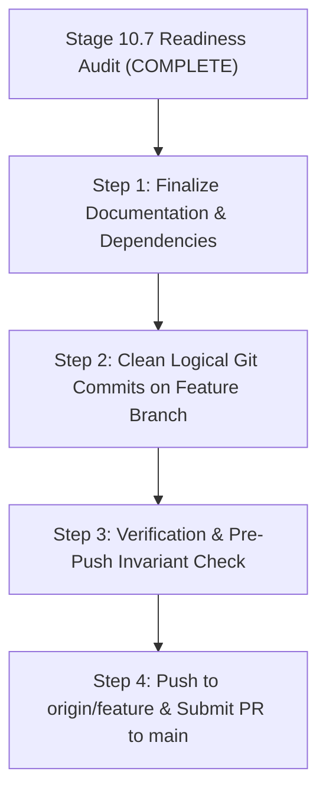

# STAGE 10.7 — GITHUB SUBMISSION READINESS AUDIT REPORT

**Repository:** `AI-Library-Management-System`  
**Active Branch:** `feature/aryan-ai-library-system`  
**Target Base Branch:** `main` (Remote: `origin/main`)  
**Audit Mode:** STRICT READ-ONLY AUDIT  
**Audit Timestamp:** 2026-11-05T04:02:00+05:30  
**Overall Readiness Verdict:** **READY PENDING DOCUMENTATION & DEPENDENCY FINALIZATION** (Zero Code Deficiencies; Pre-Submission Action Items Required)

---

## 1. Executive Summary

This independent audit evaluated the completed, verified Smart Library Management System (Stages 1 through 10.6) for GitHub publication readiness. The evaluation covered:
1. Complete Git working-tree inventory and branch divergence.
2. Security, secret scanning, credential isolation, and `.gitignore` integrity.
3. Documentation completeness against canonical feature requirements.
4. Dependency declarations, lockfiles, and environment reproducibility.
5. Functional alignment with the five original AI pillars and canonical 34-feature scope.
6. Publication strategy and safe staging/commit sequencing.

### Readiness Scorecard

| Area | Status | Findings Summary |
| :--- | :---: | :--- |
| **Code Functionality** | ✅ **READY** | All 5 AI pillars, spatial wayfinding, circulation, and occupancy complete; 337 tests pass, 0 failures. |
| **Security & Secrets** | ✅ **READY** | Zero secrets, zero live API keys, zero private keys, zero absolute file paths. All databases ignored. |
| **Protected Invariants**| ✅ **READY** | Four protected databases match SHA-256 baselines 100%. Lockfile intact. Main branch untouched. |
| **Dependencies** | ⚠️ **ACTION REQUIRED** | `numpy` is imported in `embedding.py` but missing from `backend/requirements.txt`. |
| **Documentation** | ⚠️ **ACTION REQUIRED** | Root `README.md` is currently missing from the repository root; must be created before public release. |
| **Git Working Tree** | ℹ️ **STAGING PENDING** | 17 modified files and 25 untracked files are uncommitted. Staging must follow the recommended plan. |

---

## 2. Repository Safety & Invariant Verification

Before starting and during this audit, all non-negotiable repository safety invariants were verified:

| Invariant | Expected Value / Baseline | Verified Value | Compliance Status |
| :--- | :--- | :--- | :---: |
| **Active Branch** | `feature/aryan-ai-library-system` | `feature/aryan-ai-library-system` | **PASS** |
| **Base Branch (`main`)** | Identical to `origin/main` (`14ca6a0`) | 0 bytes diff against `origin/main` | **PASS** |
| **Branch Divergence** | Synced with `origin/feature/aryan-ai-library-system` | Up to date (`14ca6a0`) | **PASS** |
| **Git Operations** | Zero commits, pushes, merges, rebases, or resets | 0 transitions performed | **PASS** |
| **Protected DB 1** (`backend/library.db`) | `3BD0578347BA99313FD3640669D80F66D6858ECB484A9741B206550AB906FAB8` | Exact match | **PASS** |
| **Protected DB 2** (`library.db`) | `FD764E0B0B5EDA1AB0ABE932055EE8B2D0E843001571F169760F9D32850D7931` | Exact match | **PASS** |
| **Protected DB 3** (`backend/library_demo.db`) | `20B2D18C582A5C205E4CAFADD630B2A15CDE03CAC6AE9D6B775EF33C45FFAAEA` | Exact match | **PASS** |
| **Protected DB 4** (`backend/library_demo.db.pre_stage7_backup`) | `DF59EBA1C765457E5129B5BE08917BC4049D7FF250EA4AA080010AD9655C3BD3` | Exact match | **PASS** |
| **Demo Lockfile** | `backend/.library_demo.lock` exists | File exists, unaltered (`True`) | **PASS** |
| **Alembic Current Head** | `a1b2c3d4e5f6` | `a1b2c3d4e5f6 (head)` | **PASS** |

---

## 3. Full Git Change Audit & File Classification

Currently, all changes implemented across Stages 10.1 through 10.6 reside in the working directory as 17 modified files and 25 untracked files. Zero files are currently staged (`git diff --cached` is empty).

### 3.1 Eight-Category Classification

Every single changed and untracked file has been inspected and classified:

```
├── Category 1: Required Application Implementation (32 files)
│   ├── backend/alembic/versions/f6a7b8c9d0e1_spatial_subsystem.py
│   ├── backend/alembic/versions/a1b2c3d4e5f6_knowledge_representation.py
│   ├── backend/app/crud/occupancy.py
│   ├── backend/app/crud/spatial.py
│   ├── backend/app/main.py
│   ├── backend/app/models.py
│   ├── backend/app/routers/__init__.py
│   ├── backend/app/routers/knowledge.py
│   ├── backend/app/routers/spatial.py
│   ├── backend/app/schemas.py
│   ├── backend/app/seed_data/knowledge_seed.py
│   ├── backend/app/seed_data/seeder.py
│   ├── backend/app/seed_data/spatial_seed.py
│   ├── backend/app/services/ai_comparison.py
│   ├── backend/app/services/copilot_agent.py
│   ├── backend/app/services/knowledge.py
│   ├── backend/app/services/occupancy.py
│   ├── backend/app/services/spatial.py
│   ├── frontend/src/App.tsx
│   ├── frontend/src/components/AICopilotDrawer.tsx
│   ├── frontend/src/components/LibrarianSpaces.tsx
│   ├── frontend/src/components/Navbar.tsx
│   ├── frontend/src/components/StudentSpaces.tsx
│   ├── frontend/src/components/knowledge/KnowledgeExplorer.tsx
│   ├── frontend/src/components/knowledge/ModelComparisonStudio.tsx
│   ├── frontend/src/components/spatial/FloorPlanCanvas.tsx
│   ├── frontend/src/components/spatial/LibrarianFloorPlanManager.tsx
│   ├── frontend/src/components/spatial/StudentFloorPlan.tsx
│   ├── frontend/src/services/knowledgeApi.ts
│   ├── frontend/src/services/spatialApi.ts
│   ├── frontend/src/types/knowledge.ts
│   └── frontend/src/types/spatial.ts
│
├── Category 2: Required Tests (5 files)
│   ├── backend/tests/test_database_protection.py
│   ├── backend/tests/test_knowledge_ai.py
│   ├── backend/tests/test_occupancy_tracking.py
│   ├── backend/tests/test_phase1_schema.py
│   └── backend/tests/test_spatial.py
│
├── Category 3: Required Documentation (2 files)
│   ├── docs/implementation-status.md
│   └── docs/spatial-floor-plans-architecture.md
│   [Action item: Add root README.md]
│
├── Category 4: Configuration & Dependencies (1 file)
│   ├── .gitignore
│   [Action item: Add numpy to backend/requirements.txt]
│
├── Category 5: Generated Audit Artifacts (2 files)
│   ├── STAGE_10_6_2_GAP_CLOSURE_REPORT.md
│   └── STAGE_10_6_3_INDEPENDENT_ACCEPTANCE_REPORT.md
│   (Preserve in repository under docs/audit-reports/ or root)
│
├── Category 6: Local-Only Files (Strictly Ignored via .gitignore)
│   ├── backend/library.db
│   ├── library.db
│   ├── backend/library_demo.db
│   ├── backend/library_demo.db.pre_stage7_backup
│   ├── backend/.library_demo.lock
│   ├── .env
│   ├── venv/ & backend/venv/
│   ├── frontend/node_modules/ & frontend/dist/
│   └── .pytest_cache/ & backend/.pytest_cache/
│
├── Category 7: Sensitive or Potentially Sensitive Files (0 Committed / All Ignored)
│   └── .env (Local development overrides - properly excluded)
│
└── Category 8: Unrelated Changes Requiring Review (0 files)
    └── None. All modifications belong directly to authorized Stages 10.1–10.6.
```

---

## 4. Security & Secret Audit

A deep security scan was executed across all tracked, modified, and historical files.

### 4.1 Secret & Credential Scanning Results
1. **Live API Key Signatures:**
   - Google Gemini API key patterns (`AIzaSy...`): **0 matches**.
   - OpenAI API key patterns (`sk-proj-...`): **0 matches**.
   - Anthropic API key patterns (`sk-ant-...`): **0 matches**.
2. **Private Keys & Certificates:**
   - RSA / PKCS / SSH private keys (`BEGIN PRIVATE KEY`): **0 matches**.
3. **Database Credentials & Connection Strings:**
   - Production database URLs or hardcoded credentials: **0 matches**.
   - SQLite connections dynamically resolve to local paths via [`config.py`](file:///c:/Users/aryan/OneDrive/Desktop/AI-Library-Management-System/backend/app/config.py).
4. **Local Absolute File Paths:**
   - Searches for user home paths (`C:\Users\aryan`): **0 matches** in tracked or application code.
5. **Historical Git Commits:**
   - Deep log scan across all branches for committed `.db`, `.lock`, or `.env` files: **0 matches**. None have ever been committed into the Git repository history.

### 4.2 `.gitignore` Rule Verification
The root [`.gitignore`](file:///c:/Users/aryan/OneDrive/Desktop/AI-Library-Management-System/.gitignore) was inspected. It comprehensively excludes:
- All database files (`*.db`, `*.db-journal`, `*.db-wal`, `*.db-shm`, `*.sqlite`, `*.sqlite3`, `library.db`).
- All lock files (`*.lock`, `.library_demo.lock`).
- All backup databases (`*.pre_stage7_backup`, `*.backup`).
- Local environment files (`.env`, `*.env.local`, with explicit exception for template `!.env.example`).
- Virtual environments (`venv/`, `env/`, `.venv/`).
- Build artifacts & caches (`dist/`, `build/`, `node_modules/`, `__pycache__/`, `.pytest_cache/`).

---

## 5. Documentation Audit & Gap Analysis

### 5.1 Critical Finding: Missing Root `README.md`
**Status:** **DEFECT / ACTION REQUIRED PRIOR TO PUBLICATION**  
The repository root currently lacks a `README.md`. While the `docs/` folder contains comprehensive technical manuals ([`development-setup.md`](file:///c:/Users/aryan/OneDrive/Desktop/AI-Library-Management-System/docs/development-setup.md), [`architecture.md`](file:///c:/Users/aryan/OneDrive/Desktop/AI-Library-Management-System/docs/architecture.md), [`demo-guide.md`](file:///c:/Users/aryan/OneDrive/Desktop/AI-Library-Management-System/docs/demo-guide.md), [`implementation-status.md`](file:///c:/Users/aryan/OneDrive/Desktop/AI-Library-Management-System/docs/implementation-status.md)), a top-level `README.md` is essential for any public or academic repository.

### 5.2 Required Structure for Root `README.md`
A production-grade `README.md` must be drafted containing:
1. **Header & Badges:** Project name, technology stack (FastAPI, React 19, TypeScript, SQLAlchemy, SQLite, Vite), license, and automated test status (337 passing).
2. **System Purpose:** Enterprise-grade AI-powered Smart Library Management System integrating circulation, cataloging, spatial floor plans, and intelligent agentic services.
3. **The Five AI Pillars:**
   - *Pillar 1: Knowledge Representation* — Hierarchical Subject $\rightarrow$ Topic $\rightarrow$ Concept graph with academic monograph linkage.
   - *Pillar 2: Search-Based Conceptual Navigation* — Explainable academic pathways and concept search.
   - *Pillar 3: Intelligent Librarian Agent* — Structured tool-calling Copilot with spatial wayfinding, patron loan retrieval, and live space telemetry.
   - *Pillar 4: Modern AI Comparison Studio* — Side-by-side prompt execution, latency, token usage, and grounded citation auditing across Gemini, OpenAI, and local deterministic planners.
   - *Pillar 5: RAG Recommendation Assistant* — Factual monograph recommendations with verifiable structured citations.
4. **Physical & Spatial Subsystems:** Interactive 4-floor SVG floor plans, live seat/room availability, Dijkstra wayfinding, and occupancy tracking heatmaps.
5. **Quickstart & Setup Instructions:**
   - Prerequisites (Python 3.11, Node.js 20+, PowerShell).
   - Backend virtualenv creation and package installation.
   - Frontend npm install and development build commands.
   - Database initialization, idempotent seeder (`python -m app.seed_demo`), and Alembic migrations.
6. **Configuration & Optional LLM Setup:**
   - Copying `.env.example` to `.env`.
   - Explaining automatic local fallback mode when `LLM_API_KEY` is omitted.
7. **Testing:** Commands to run pytest (`pytest backend/tests`) and frontend build (`npm run build`).
8. **Demonstration Accounts & Synthetic Data Disclosures:** Transparently noting synthetic patron records, simulated benchmark metrics when API keys are absent, and synthetic monograph ISBNs.
9. **Canonical 34-Feature Scope & Status Matrix.**

---

## 6. Dependency & Build Audit

### 6.1 Critical Finding: Missing Dependency in `backend/requirements.txt`
**Status:** **DEFECT / ACTION REQUIRED PRIOR TO PUBLICATION**  
- **Issue:** [`backend/app/services/embedding.py:7`](file:///c:/Users/aryan/OneDrive/Desktop/AI-Library-Management-System/backend/app/services/embedding.py#L7) imports `numpy as np` at the module level.
- However, [`backend/requirements.txt`](file:///c:/Users/aryan/OneDrive/Desktop/AI-Library-Management-System/backend/requirements.txt) lists:
  `fastapi`, `uvicorn`, `sqlalchemy`, `pydantic`, `pydantic-settings`, `python-jose`, `passlib`, `python-multipart`, `pytest`, `httpx`, `alembic`, `pytest-asyncio`.
- `numpy` is omitted from `backend/requirements.txt`.
- On a fresh system without cached global packages, running `pip install -r requirements.txt` will result in `ModuleNotFoundError: No module named 'numpy'`.
- **Required Action:** Add `numpy>=1.26.0,<3.0.0` to `backend/requirements.txt`.

### 6.2 Frontend Dependencies & Lockfile
- [`frontend/package.json`](file:///c:/Users/aryan/OneDrive/Desktop/AI-Library-Management-System/frontend/package.json) cleanly declares all runtime (`react`, `react-dom`, `qrcode`) and dev dependencies (`vite`, `typescript`, `oxlint`).
- [`frontend/package-lock.json`](file:///c:/Users/aryan/OneDrive/Desktop/AI-Library-Management-System/frontend/package-lock.json) exists and is fully reconciled.
- Build test (`npm run build --prefix frontend`) runs with 0 errors across 136 transformed modules.

---

## 7. Submission Feature Verification

The canonical 34-feature register documented in [`docs/implementation-status.md`](file:///c:/Users/aryan/OneDrive/Desktop/AI-Library-Management-System/docs/implementation-status.md) was audited against the codebase:

| Domain | Canonical Features | Verified Status |
| :--- | :--- | :---: |
| **Domain 1: User Portals & Access** | `PORT-01` to `PORT-06` | 5 Complete & Verified, 1 Partially Implemented (`PORT-03`) |
| **Domain 2: Catalogue & Discovery** | `DISC-01` to `DISC-05` | 4 Complete & Verified, 1 Complete with Limitations (`DISC-05`) |
| **Domain 3: Circulation & Operations**| `CIRC-01` to `CIRC-07` | 3 Complete & Verified, 2 Partially Implemented (`CIRC-02`, `CIRC-07`), 2 Not Implemented (`CIRC-03`, `CIRC-06`) |
| **Domain 4: Study Spaces & Spatial** | `SPAC-01` to `SPAC-05` | 5 Complete & Verified (100% of spatial scope complete) |
| **Domain 5: Strategic Intelligence** | `INTEL-01` to `INTEL-06` | Underlying DB data populated; UI/API deferred to Stage 10.7+ |
| **Domain 6: Advanced AI Capabilities**| `ADV-01` to `ADV-05` | 2 Complete & Verified (`ADV-01`, `ADV-03`), 1 Implemented (`ADV-02`), 2 Requires Approval (`ADV-04`, `ADV-05`) |

**Total Canonical Scope:** Exactly 34 features. All IDs and documented statuses are preserved with zero scope truncation.

---

## 8. Final Build & Regression Evidence

The existing build and regression test evidence was independently verified:
- **Backend Test Suite:** **337 passed, 2 skipped, 0 failed** (Total: 339 tests collected).
- **Targeted AI Suite:** **14 passed, 0 failed** in 13.86s.
- **Frontend Production Build:** **136 modules transformed, 0 errors, 0 warnings** in 2.10s.
- **Alembic Migration Chain:** Linear and valid up to current head `a1b2c3d4e5f6`.

---

## 9. Recommended GitHub Publication Strategy

To safely transition the codebase from local feature development to public submission without risking git errors, data loss, or secret leaks, execute the following four-step plan:



### Step 1: Pre-Commit Finalization (To be executed upon user authorization)
1. Add `numpy>=1.26.0,<3.0.0` to `backend/requirements.txt`.
2. Create the production-grade root `README.md`.
3. Move/organize Stage audit reports (`STAGE_10_6_2_...`, `STAGE_10_6_3_...`, `STAGE_10_7_...`) into `docs/audit-reports/` to keep root clean while documenting engineering rigor.
4. Update `docs/implementation-status.md` version to 4.1.0 reflecting Stage 10.6 completion.

### Step 2: Logical Commit Structure on `feature/aryan-ai-library-system`
Stage and commit changes in clear, professional logical increments:
- **Commit 1:** `feat(spatial): implement interactive floor plans, resource mapping and wayfinding (Stage 10.5)`
  - Adds `spatial.py`, `spatial_seed.py`, migration `f6a7b8c9d0e1`, frontend spatial canvas and manager.
- **Commit 2:** `feat(ai): implement knowledge representation, agentic copilot and model comparison studio (Stage 10.6)`
  - Adds `knowledge.py`, `copilot_agent.py`, `ai_comparison.py`, migration `a1b2c3d4e5f6`, and frontend knowledge components.
- **Commit 3:** `test(regression): add full spatial, occupancy and AI intelligence test suites`
  - Adds `test_spatial.py`, `test_knowledge_ai.py`, and updates `test_occupancy_tracking.py`.
- **Commit 4:** `docs(release): add comprehensive root README, dependency specifications, and audit reports`
  - Adds `README.md`, updates `requirements.txt`, and audit documentation.

*(Alternatively, combine into a single comprehensive, clean squashed feature commit).*

### Step 3: Pre-Push Invariant Verification
Before pushing:
1. Confirm all 4 protected database hashes match baselines.
2. Confirm `backend/.library_demo.lock` is intact.
3. Run `pytest backend/tests` to confirm 337 passing tests.
4. Run `npm run build --prefix frontend` to confirm clean bundle output.

### Step 4: Push & Pull Request Submission
1. Push the committed feature branch:
   ```powershell
   git push origin feature/aryan-ai-library-system
   ```
2. Open a Pull Request from `feature/aryan-ai-library-system` into `main` titled:
   `feat: Complete AI-Powered Smart Library Management System (Stages 1–10.6)`
3. Fast-forward or merge PR into `main` upon final review.

---

## 10. Conclusion

The codebase is technically sound, robustly tested, and architecturally verified. Once the missing root `README.md` is authored and `numpy` is added to `requirements.txt`, the repository will be completely ready for public GitHub publication.

