# Athenaeum: System Architecture Specification

## 1. Executive Architecture Summary

**Athenaeum** is an enterprise-grade, AI-augmented academic library management and intelligence platform. It bridges traditional physical circulation lifecycles with modern digital discovery, spatial wayfinding, and an agentic multi-pillar artificial intelligence engine.

The platform is architected around a decoupled client-server paradigm:
- **Client Tier**: Single Page Application (SPA) built with React 19, TypeScript 5.8, and Vite 5.4, utilizing atomic component isolation and responsive glassmorphic design systems.
- **Application Tier**: High-throughput asynchronous REST API built on FastAPI 0.110+ (Starlette / Pydantic v2), organized into specialized modular domain routers and stateless domain service engines.
- **Persistence Tier**: Relational data store managed via SQLAlchemy 2.0 ORM with Alembic schema versioning, strictly isolating transactional workflows, foreign key constraints, and spatial geometries.
- **Intelligence & AI Tier**: Multi-provider LLM abstraction layer (Google Gemini 3.1, OpenAI GPT-4o, Local Ollama, and Deterministic Fallback), dense semantic vector retrieval via SentenceTransformers (`all-MiniLM-L6-v2`, 384 dimensions), Reciprocal Rank Fusion (RRF), and a tool-calling Librarian Agent.

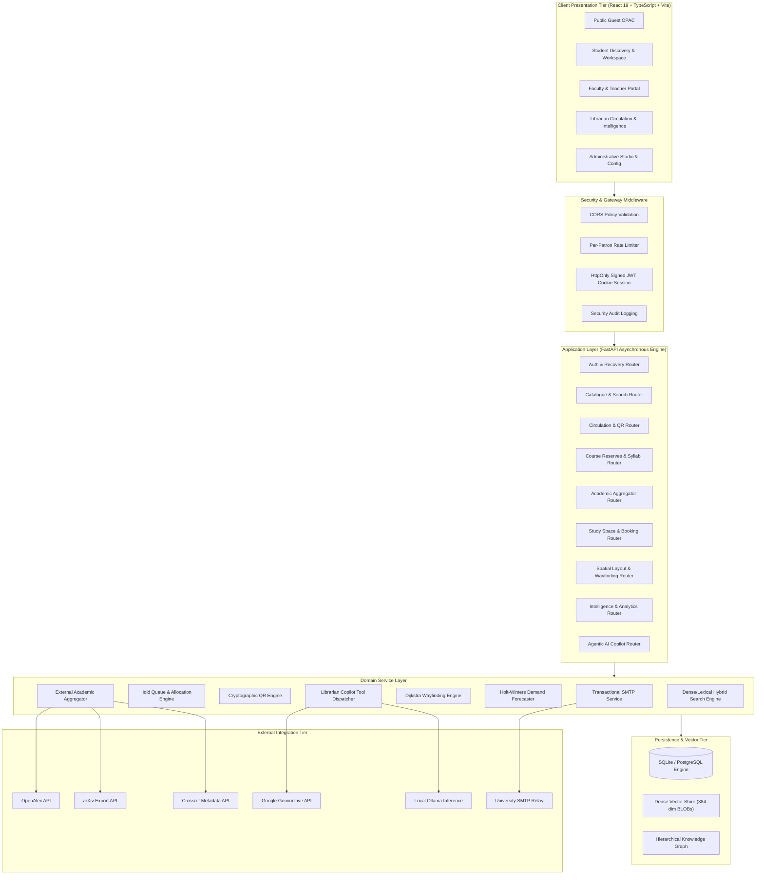

---

## 2. Container-Level Architecture

The Athenaeum deployment model comprises five decoupled execution boundaries designed for resilience and local testability:

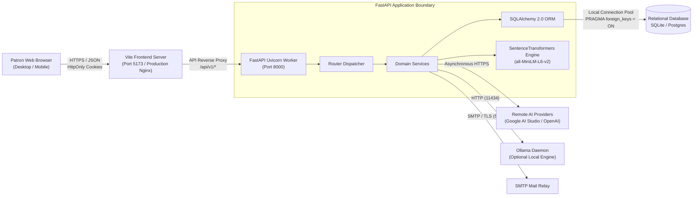

---

## 3. Frontend Component Architecture

The frontend application follows a strict modular structure centered on role-tailored workspaces and reactive state containment:

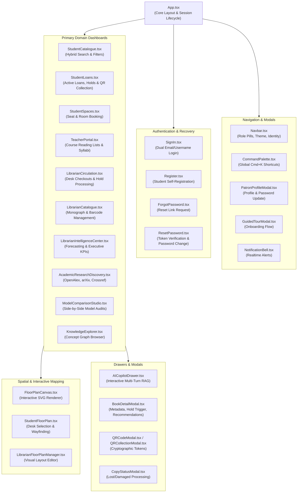

---

## 4. Backend Service Architecture

The backend implements a Clean Architecture layered service pattern. Routers handle HTTP protocol translation, request validation via Pydantic v2 schemas, and dependency injection, delegating all domain rules to stateless service modules:

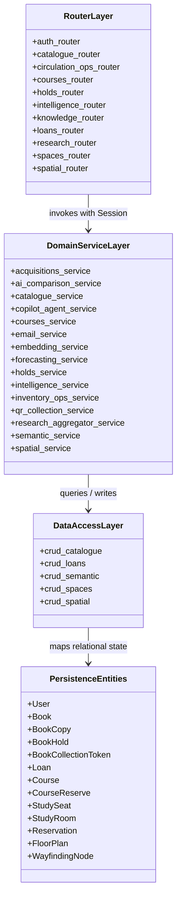

---

## 5. Relational Database Architecture

Athenaeum manages 31 relational tables linked by rigorous foreign keys, check constraints, and performance indexes:

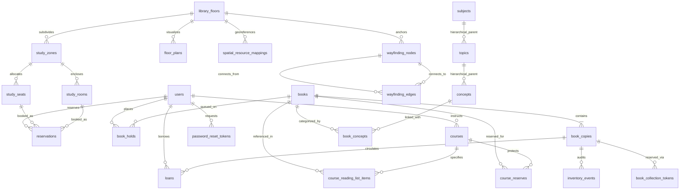

---

## 6. AI Copilot Request Lifecycle

When a patron submits an inquiry to the AI Assistant, the request executes through a deterministic, guardrailed multi-stage pipeline:

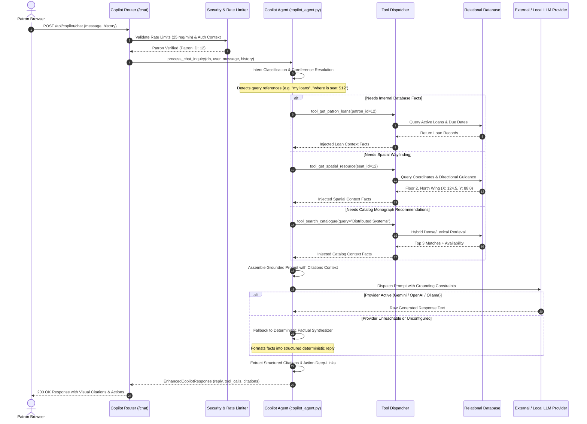

---

## 7. Hybrid Search & Reciprocal Rank Fusion (RRF) Pipeline

The catalog search engine unifies dense vector semantics with exact lexical matching using Reciprocal Rank Fusion ($k = 60.0$):

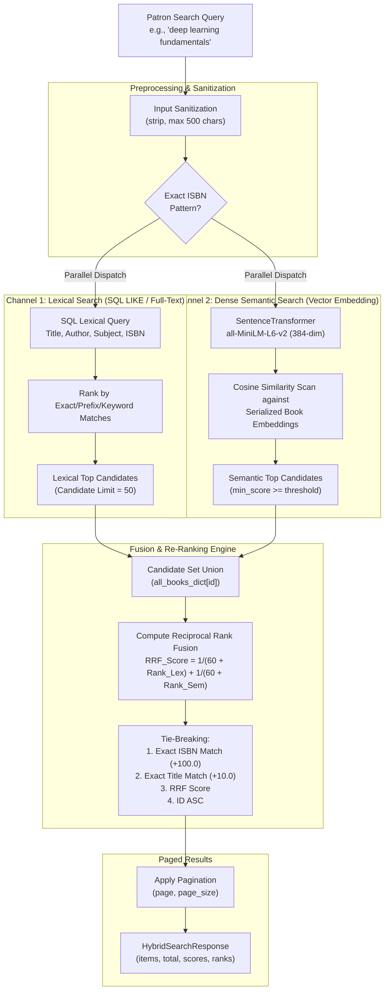

---

## 8. Grounded RAG Pipeline

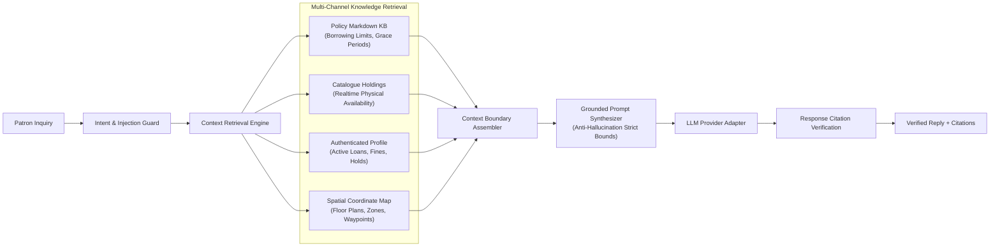

---

## 9. Authentication & Password Recovery Lifecycle

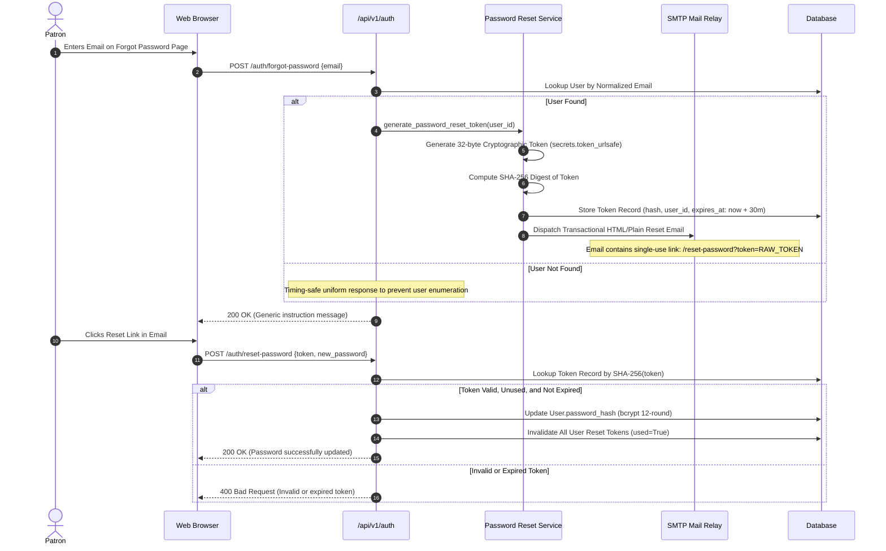

---

## 10. Circulation & Hold Queue Allocation Lifecycle

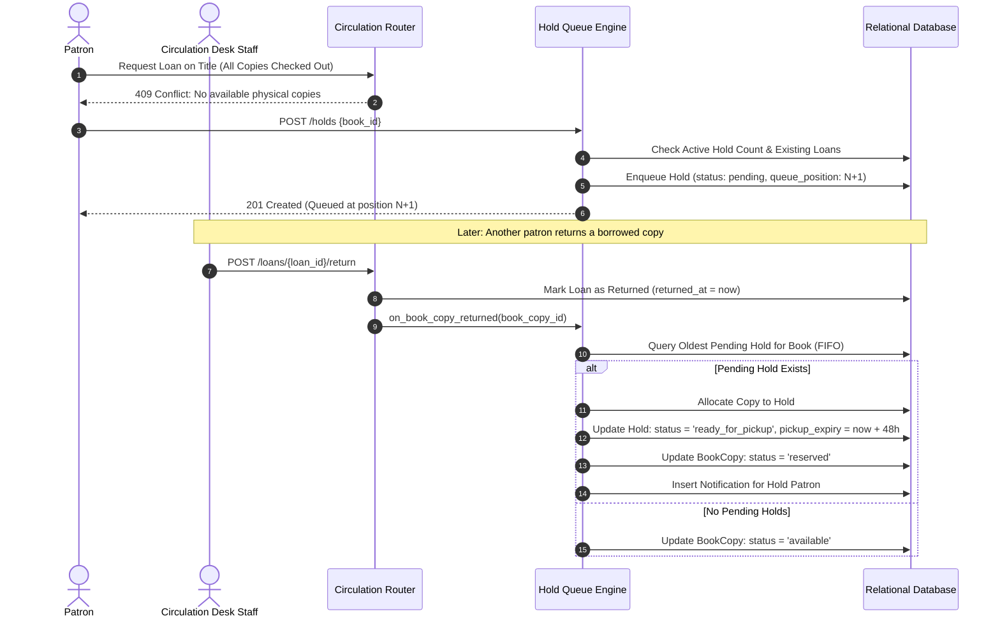

---

## 11. Cryptographic QR Collection Workflow

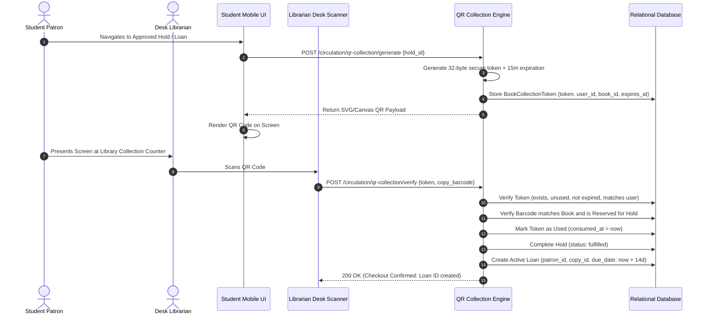

---

## 12. Course Reserves Management Workflow

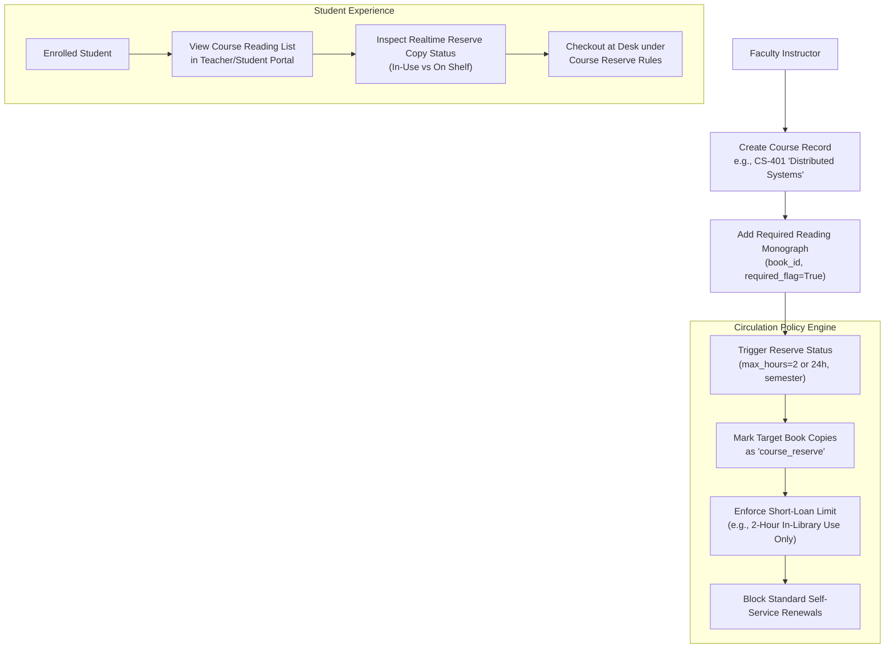

---

## 13. Dijkstra Spatial Wayfinding Engine

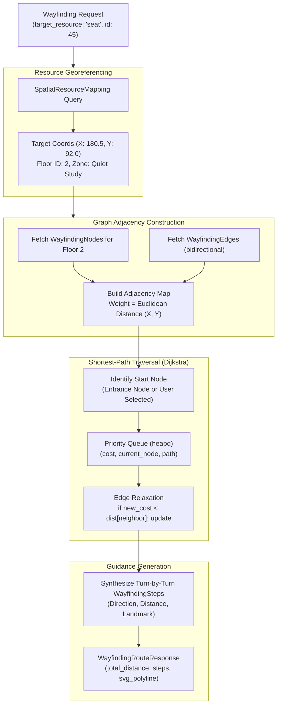

---

## 14. Intelligence & Demand Forecasting Architecture

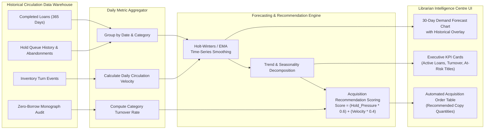
