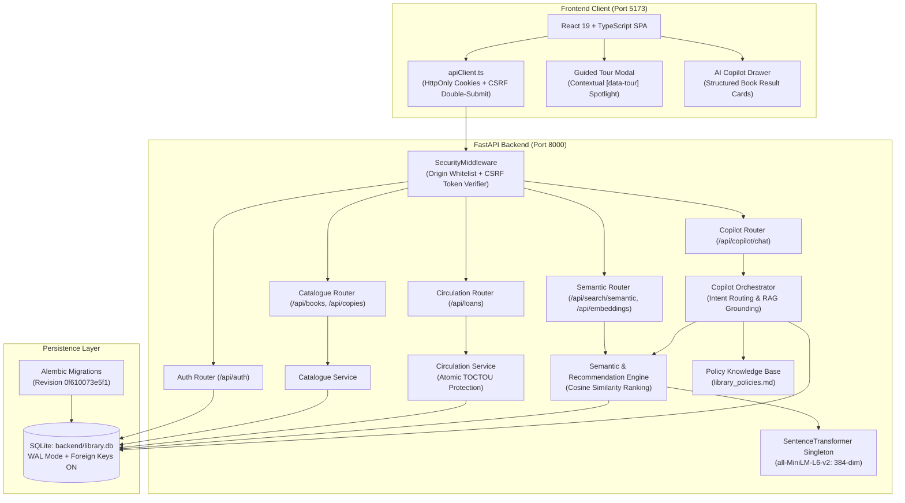
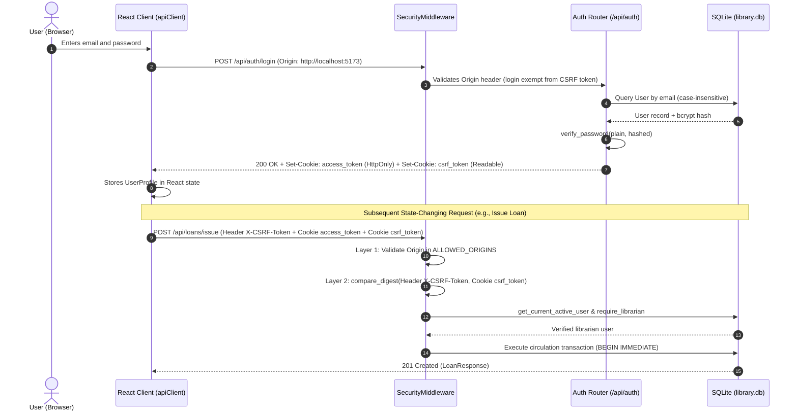
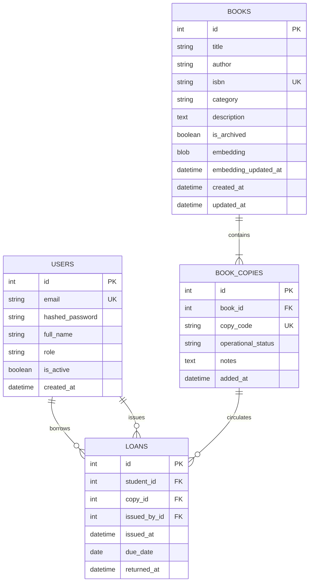

# System Architecture & Technical Baseline

**Document Version:** 1.0.0  
**Phase:** Phase 0 Baseline  
**Project:** AI-Powered Smart Library, Learning & Resource Management Platform  
**Target Repository:** `AI-Library-Management-System`  
**Active Branch:** `feature/aryan-ai-library-system`  

---

## 1. System Overview

The **AI Library Management System** is a decoupled full-stack web application designed for academic library circulation, physical copy tracking, neural vector semantic search, content-based recommendations, and grounded conversational assistance.

The platform integrates:
- A high-performance **FastAPI (Python 3.11)** backend providing asynchronous and transactional REST endpoints.
- A **React 19 + TypeScript + Vite** single-page application (SPA) with responsive design and accessibility controls.
- A hardened **SQLite 3** persistence layer operating in Write-Ahead Logging (WAL) mode with upfront lock acquisition (`BEGIN IMMEDIATE`).
- A local **SentenceTransformers (`all-MiniLM-L6-v2`)** neural vector embedding pipeline producing 384-dimensional dense semantic vectors.
- An **AI Library Copilot** featuring deterministic intent classification, live database grounding, policy retrieval, and a fallback provider mechanism.

---

## 2. Frontend / Backend Interaction & Authentication Flow

### Authentication Architecture
- **Session Mechanism:** Stateless JSON Web Tokens (JWT) signed using HMAC-SHA256 (`HS256`).
- **Token Delivery:** Delivered strictly inside a browser-managed, secure `HttpOnly` cookie named `access_token` (`SameSite=Lax`, 8-hour expiration).
- **Client Access:** JavaScript code running in the browser cannot access `access_token` via `document.cookie`, neutralizing Cross-Site Scripting (XSS) token theft.
- **CSRF Defense:** Implements the Double-Submit Cookie pattern:
  1. At login, the server sets a second, readable cookie named `csrf_token` containing a cryptographically secure 32-byte URL-safe token.
  2. The frontend client wrapper ([`apiClient.ts`](file:///c:/Users/aryan/OneDrive/Desktop/AI-Library-Management-System/frontend/src/services/apiClient.ts)) reads `csrf_token` from `document.cookie` and transmits it in the `X-CSRF-Token` HTTP header on all state-changing requests (`POST`, `PUT`, `PATCH`, `DELETE`).
  3. The backend [`SecurityMiddleware`](file:///c:/Users/aryan/OneDrive/Desktop/AI-Library-Management-System/backend/app/middleware/security.py) executes two validation layers:
     - **Layer 1:** Validates the `Origin` header against `ALLOWED_ORIGINS` (`http://localhost:5173`, `http://127.0.0.1:5173`).
     - **Layer 2:** Verifies that the header token matches the cookie token via constant-time comparison (`secrets.compare_digest`).

---

## 3. Database Architecture & Concurrency Control

### File Location & Path Hardening
- **Primary Database File:** `backend/library.db` (anchored via [`config.py`](file:///c:/Users/aryan/OneDrive/Desktop/AI-Library-Management-System/backend/app/config.py) using `BACKEND_DIR / "library.db"`).
- **Working-Directory Determinism:** The SQLite connection string resolves to an absolute path on Windows (`sqlite:///C:/.../backend/library.db`) regardless of whether the process is started from the repository root, the `backend/` directory, or an external script runner.
- **Legacy Root File:** `library.db` at the repository root is preserved as an empty legacy file and is not accessed by the application runtime.

### Concurrency & Integrity Settings
- **Write-Ahead Logging (WAL):** Initialized in [`database.py`](file:///c:/Users/aryan/OneDrive/Desktop/AI-Library-Management-System/backend/app/database.py#L229) using `PRAGMA journal_mode = WAL;` outside of active transactions. WAL mode allows concurrent readers to operate without waiting for writers.
- **Foreign Key Referential Integrity:** `PRAGMA foreign_keys = ON;` is enforced on every connection checkout.
- **Lock Contention:** `PRAGMA busy_timeout = 5000;` prevents immediate `sqlite3.OperationalError: database is locked` exceptions under concurrent write operations.
- **TOCTOU Protection:** The [`atomic_write`](file:///c:/Users/aryan/OneDrive/Desktop/AI-Library-Management-System/backend/app/database.py#L113) context manager issues `BEGIN IMMEDIATE` upfront before any reads execute. This locks the SQLite database for writing immediately, eliminating Time-of-Check to Time-of-Use race conditions during concurrent book checkouts.

---

## 4. AI & Semantic Search Architecture

### Dual-Layer AI Engine
The system distinguishes strictly between actual machine learning model execution and deterministic RAG synthesis:

1. **Neural Vector Embedding & Similarity Ranking (Real ML Model):**
   - **Pretrained Weights:** `sentence-transformers/all-MiniLM-L6-v2` executed via PyTorch.
   - **Vector Dimensionality:** 384-dimensional dense float vectors.
   - **Document Structure:** `Title: {title} | Author: {author} | Category: {category} | Description: {description}`.
   - **Serialization:** Stored as raw binary blobs (`LargeBinary`, 1,536 bytes) in `books.embedding`.
   - **Similarity Math:** Cosine similarity computed in NumPy using unit-normalized vector dot products:
     $$\text{sim}(\vec{q}, \vec{d}) = \frac{\vec{q} \cdot \vec{d}}{\|\vec{q}\| \|\vec{d}\|}$$
   - **Content-Based Recommendations:** Computes pairwise similarity between a selected book's embedding and all active monographs in the catalogue, excluding the source title.

2. **AI Library Copilot (Intent Classification & Grounding):**
   - **Conversational Intent Layer:** Token and regex classifier in [`copilot.py`](file:///c:/Users/aryan/OneDrive/Desktop/AI-Library-Management-System/backend/app/services/copilot.py#L102) identifying `GREETING`, `THANKS`, `GOODBYE`, `HELP`, `PERSONAL_LOANS`, `POLICY_RULES`, `BOOK_SEARCH`, and `AMBIGUOUS`.
   - **Anti-Hallucination Grounding:** Personal loan queries are resolved by live SQL queries strictly scoped to `student_id == current_user.id`. Policy rules are loaded from [`library_policies.md`](file:///c:/Users/aryan/OneDrive/Desktop/AI-Library-Management-System/backend/app/knowledge/library_policies.md).
   - **Anti-Prompt-Injection:** Sanitizes non-printable control characters, strips control tokens (`<|im_start|>`), and enforces a 500-character ceiling.
   - **Provider Fallback:** If `LLM_API_KEY` is not configured, the system uses the `DeterministicFallbackProvider`, synthesizing database facts directly without failing.

---

## 5. Important Data Flows

### A. Book Circulation Loan Issuance
1. Staff librarian submits student user ID and physical copy ID to `POST /api/loans/issue`.
2. `atomic_write` transaction begins with `BEGIN IMMEDIATE`.
3. Validation rules checked:
   - Student account exists and `is_active == True`.
   - Student has `< 3` currently active loans.
   - Student has `0` overdue loans.
   - Physical copy exists and `operational_status == "available"`.
   - Partial unique index `uix_one_active_loan_per_copy` verifies no unreturned loan exists for the copy.
4. Due date calculated: `today + 14 calendar days`.
5. Loan record created with `returned_at = None`. Transaction commits.

### B. Natural-Language Semantic Search
1. Authenticated user enters a conceptual query (e.g., *"fault-tolerant event streaming"*).
2. Backend encodes the query text into a 384-dimensional `float32` vector via `SentenceTransformer.encode()`.
3. Active, unarchived monographs with non-null `embedding` blobs are queried from SQLite.
4. Deserialized database vectors are compared to the query vector via cosine similarity.
5. Results are filtered by `min_score`, sorted in descending order, paginated, and returned with similarity percentage scores.

---

## 6. Current Technical Limitations & Technical Debt

1. **Frontend Unit Test Runner Absence:**  
   The frontend relies on TypeScript type checking (`tsc -b`) and Vite production bundling (`vite build`) for verification. There is currently no configured Vitest or Jest suite in `frontend/package.json`.
2. **Upstream Node 25.2.1 Native Binding Conflict:**  
   The optional Windows binary for `oxlint` fails to load under Node.js v25.2.1. Code verification relies on Vite and TypeScript builds.
3. **In-Memory Embedding Cache Scalability:**  
   Semantic search computes pairwise cosine similarity in-memory using NumPy. While optimal for hundreds to thousands of books, collections exceeding 50,000 titles will require a dedicated vector index (e.g. SQLite-VSS, FAISS, or pgvector).
4. **LLM Provider Extensibility:**  
   The external LLM provider interface currently supports Google Gemini REST and generic OpenAI-compatible `/chat/completions` endpoints. Structured JSON output schema validation from external providers is handled via regex extraction.

