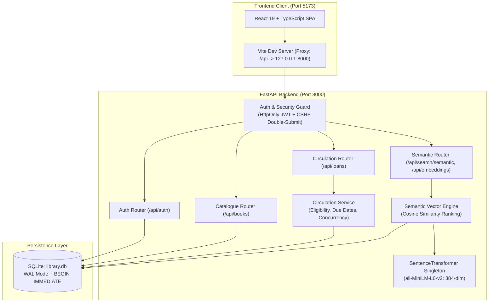
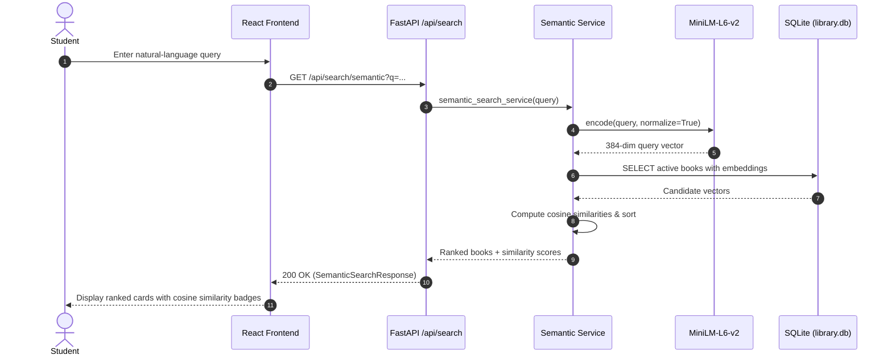
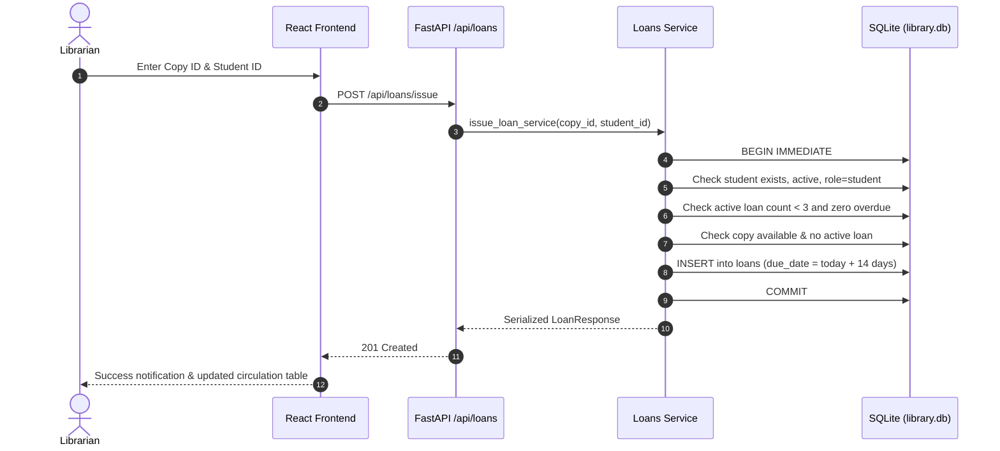

# AI Library Management System — Demonstration & Operations Guide

This guide provides complete, step-by-step instructions for running, populating, and demonstrating the **AI Library Management System** in local development.

---

## 1. System Architecture

The AI Library Management System is built on a decoupled, production-grade architecture combining a FastAPI backend, SQLite database with strict write serialization, a React/TypeScript single-page application, and local sentence-transformer vector embeddings.



---

## 2. Preparing the Demonstration Dataset

The repository includes an idempotent seed module that populates 15 realistic fictional monographs across Computer Science, AI/ML, Mathematics, Physics, Cybersecurity, and General Technology. It registers 31 physical copies with unique barcodes, creates standard demonstration accounts, configures safe circulation loans, and computes unit-normalized 384-dimensional vector embeddings.

### Seed Command
Open a PowerShell terminal in the repository root:
```powershell
cd backend
.\venv\Scripts\python.exe -m app.seed_demo
```

### Inspect Database State
To verify the populated dataset without modifying records:
```powershell
cd backend
.\venv\Scripts\python.exe -m app.seed_demo --inspect
```

Expected summary:
- **Total Users**: 4 (2 students, 2 librarians)
- **Total Books**: 15 monographs
- **Total Copies**: 31 physical items (30 available, 1 under maintenance)
- **Circulation Loans**: 1 active loan, 1 returned loan
- **AI Vector Coverage**: 15 / 15 books embedded

---

## 3. Starting the Services

Open two separate terminals in VS Code:

### Terminal 1 — Backend API
```powershell
cd c:\Users\aryan\OneDrive\Desktop\AI-Library-Management-System\backend
.\venv\Scripts\python.exe -m uvicorn app.main:app --host 127.0.0.1 --port 8000 --reload
```
*Verify output*: Uvicorn running on `http://127.0.0.1:8000` (Application startup complete).

### Terminal 2 — Frontend Application
```powershell
cd c:\Users\aryan\OneDrive\Desktop\AI-Library-Management-System\frontend
npm run dev
```
*Verify output*: Local dev server running at `http://localhost:5173`. Open this URL in your web browser.

---

## 4. End-to-End Demonstration Script

Follow this numbered script to showcase all core features to evaluators.

### Step 1: Sign in as a Librarian
1. Open `http://localhost:5173`.
2. Enter the demonstration librarian credentials:
   - **Email**: `demo_librarian@library.local`
   - **Password**: `LibrarianDemo123!`
3. Click **Sign In**.
4. **Expected Outcome**: The UI navigates to the catalogue view with staff administrative tabs: **Catalogue**, **AI Search**, **Catalogue Management**, **Circulation Desk**, and **AI Embeddings**. The user pill in the top right displays `LIBRARIAN`.

### Step 2: Add a New Book & Register Physical Copies
1. Click the **Catalogue Management** tab in the navigation bar.
2. Click the **+ Add New Book** button.
3. Fill in the book metadata:
   - **Title**: `Quantum Cryptography and Secure Communications`
   - **Author**: `Dr. Kenneth Moore`
   - **Category**: `Cybersecurity`
   - **ISBN-13**: `9780521876582` *(a valid Modulo-10 checksum)*
   - **Description**: `Foundations of quantum key distribution protocols, BB84 implementation, and quantum channel eavesdropping detection.`
4. Click **Create Book**.
5. Locate the newly created book in the table and click its **Copies** button.
6. Under **Add New Physical Copy**, enter:
   - **Barcode Code**: `SEC-QKD-001`
   - **Initial Status**: `Available`
   - **Notes**: `Secure Vault, Shelf 1`
7. Click **Register Physical Copy**.
8. Click **Done**.
9. **Expected Outcome**: The book appears in the catalogue table with `1 / 1 available`.

### Step 3: Switch to Student Account
1. Click **Sign Out** in the top-right corner.
2. Sign in using student credentials:
   - **Email**: `demo_student@library.local`
   - **Password**: `StudentDemo123!`
3. **Expected Outcome**: The navigation bar adapts to the student experience, presenting **Catalogue**, **Semantic Search**, and **My Loans**.

### Step 4: Standard Catalogue Keyword Search
1. In the **Catalogue** search bar, type `Quantum Cryptography` and press **Enter** or click **Search**.
2. **Expected Outcome**: The newly created book appears with its custom category-themed cover, showing `1 available`.
3. Filter by **Cybersecurity** in the category dropdown to see all books in that discipline.

### Step 5: Natural-Language Semantic Search
1. Click the **Semantic Search** tab.
2. Enter a conceptual query:
   ```text
   distributed streaming event pipelines and fault tolerance
   ```
3. Click **Semantic Search**.
4. **Expected Outcome**: The vector engine encodes the query via `sentence-transformers/all-MiniLM-L6-v2`, computes directional cosine similarity against catalogued vectors, and ranks:
   - *Designing Distributed Microservices and Event Meshes* (~0.81 cosine similarity)
   - Followed by related systems titles.
5. Try another query:
   ```text
   attention mechanisms and transformer language architectures
   ```
   - *Natural Language Processing with Transformers* ranks top (~0.65 cosine similarity).

### Step 6: Content-Based Recommendations
1. Click on the book card for **Designing Distributed Microservices and Event Meshes**.
2. **Expected Outcome**: The **Catalogue Record** modal opens, displaying:
   - Complete bibliographic details and ISBN.
   - Physical inventory copies and barcodes (`CS-DIST-001`, `CS-DIST-002`).
   - Inline **Related Recommendations** computed via cosine similarity against the catalogue (e.g., *Zero Trust Architecture*, *Database Internals*).
3. Close the modal.

### Step 7: Inspect Student Loans
1. Click the **My Loans** tab.
2. **Expected Outcome**: Displays the student's borrowing history:
   - **Active Loans**: 1 active loan (*Designing Distributed Microservices*, due in 12 days).
   - **Returned History**: 1 returned record (*Foundations of Deep Learning*).
   - Clear institutional return instructions; no staff override buttons.

### Step 8: Circulation Desk (Issue & Return)
1. Sign out and sign back in as **`demo_librarian@library.local`** / **`LibrarianDemo123!`**.
2. Navigate to **Circulation Desk**.
3. Under **Issue Copy to Student**, enter:
   - **Physical Copy ID**: `1` *(or any available copy ID)*
   - **Student User ID**: `3` *(the demo student's ID)*
4. Click **Issue Book Loan**.
5. **Expected Outcome**: If copy 1 is already on loan, the backend rejects it with `Copy already has an active loan` (enforcing concurrency rules). Issuing an available copy (e.g., Copy ID `2`) calculates an exact 14-day due date and displays an issuance confirmation banner.
6. In the loan table, locate an active loan and click **Record Return**.
7. Confirm the prompt.
8. **Expected Outcome**: The loan status updates to `Returned` with the return timestamp, and the physical copy immediately returns to shelf availability.

### Step 9: Vector Embeddings Health & Synchronization
1. Click the **AI Embeddings** tab.
2. **Expected Outcome**: Displays real database vector metrics:
   - Total Catalogue Books
   - Up-to-Date Vectors
   - Missing / Stale counts
   - Server Model Runtime (`Online & Ready`)
3. Check **Force recompute all books** and click **Run Embedding Synchronization**.
4. **Expected Outcome**: The progress indicator displays the batch re-encoding process and updates the timestamp of all vectors.

---

## 5. Sequence Workflows

### Student Discovery & Recommendations Workflow


### Circulation Loan Issuance Workflow


---

## 6. Feature Status & Verification Matrix

| Capability | Implementation Type | Status | Verification Detail |
| :--- | :--- | :--- | :--- |
| **Authentication & RBAC** | Backend Service + HttpOnly JWT | **Verified** | Session verification, role guards (Student vs Librarian), CSRF double-submit token. |
| **Catalogue & Inventory** | FastAPI CRUD + Pydantic | **Verified** | ISBN-13 checksum validation, operational statuses, dynamic availability counts. |
| **Loan Circulation** | FastAPI Service + SQLite | **Verified** | 14-day due date calculation, max-3 loan limit, return processing, overdue filters. |
| **Semantic Search** | SentenceTransformers (all-MiniLM-L6-v2) | **Verified** | Real 384-dimensional dense vectors, cosine similarity ranking, 503 fallback. |
| **Content Recommendations** | Vector similarity (Cosine metric) | **Verified** | In-catalogue similarity matching, exclusion of source book, exclusion of stale vectors. |
| **Model Runtime Fallback** | Exception-handling guard | **Verified** | Keyword catalogue search remains fully operational if the PyTorch model is offline. |

---

## 7. Troubleshooting Common Issues

1. **`Failed to execute 'text' on 'Response'` / Login error**:
   - *Cause*: FastAPI backend is not running on port 8000.
   - *Solution*: Start the backend via `.\venv\Scripts\python.exe -m uvicorn app.main:app --port 8000` before accessing the frontend.

2. **`Sentence Transformer Model Unavailable (503)`**:
   - *Cause*: `sentence-transformers` is missing in `backend/venv`.
   - *Solution*: Run `pip install sentence-transformers torch` inside `backend/venv`. The model weights will automatically load from local HuggingFace cache.

3. **Database locked / `RuntimeError: Cannot start atomic_write`**:
   - *Cause*: A long-running write transaction or concurrent unclosed read session.
   - *Solution*: Restart the Uvicorn server; SQLite WAL mode ensures clean recovery.
