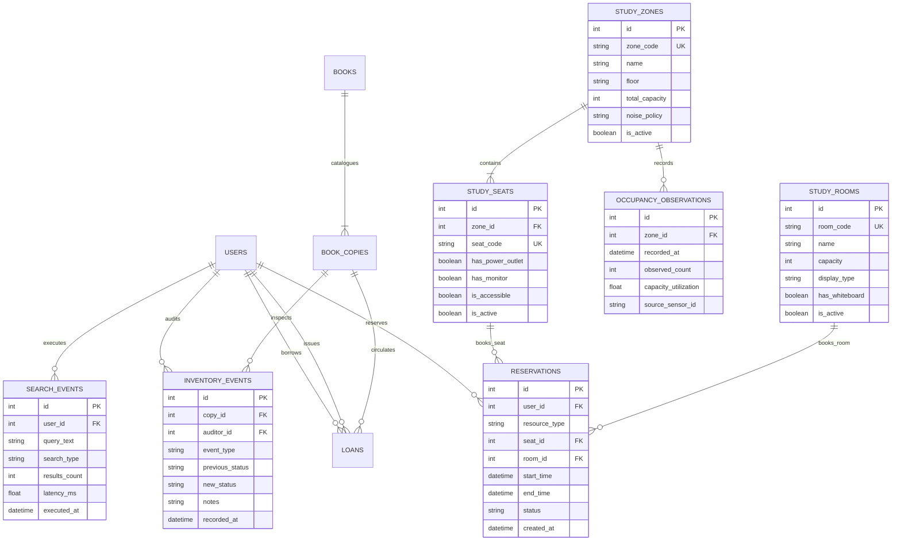
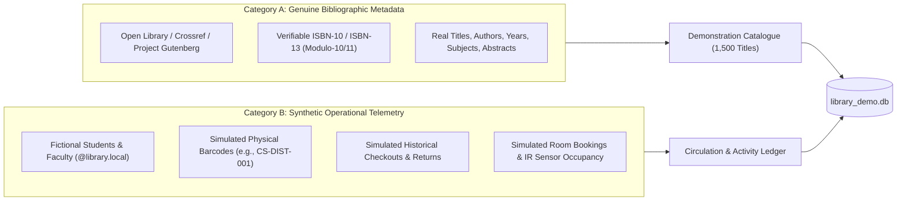
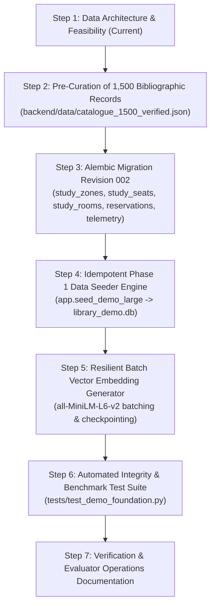

# Phase 1 — Step 1: Data Foundation Design & Feasibility Audit

**Document Version:** 1.0.0  
**Status:** Approved Architectural Design  
**Target Environment:** Isolated Demonstration Database (`backend/library_demo.db`)  
**Active Development Branch:** `feature/aryan-ai-library-system`  

---

## 1. Current-State Findings

### Existing Data Model
The active production/development baseline consists of 4 relational tables in SQLite (`backend/library.db`), managed via Alembic revision `0f610073e5f1`:
1. `users`: 4 seeded accounts (2 students, 2 librarians). Roles are constrained to `'student'` and `'librarian'`.
2. `books`: 15 academic monographs. Stores title, author, isbn, category, description, archived status, and raw binary vector embeddings (`embedding: LargeBinary`, 384 `float32` dimensions).
3. `book_copies`: 31 physical items. Tracks `copy_code` (unique barcode), `operational_status` (`available`, `maintenance`, `lost`, `retired`), and notes.
4. `loans`: 2 records (1 active, 1 returned). Stores `student_id`, `copy_id`, `issued_by_id`, `issued_at`, `due_date`, and `returned_at`. Enforces `uix_one_active_loan_per_copy` partial index.

### Existing Deficits Relative to Phase 1 Scope
- **User Roles:** The current schema and dependencies recognize only `'student'` and `'librarian'`. There is no provision for `'teacher'` accounts.
- **Physical & Space Resources:** The existing database has **zero entities** for study seats, group study rooms, study zones, occupancy observations, or space reservations.
- **Auditing & Telemetry:** There are no models or tables for catalogue search telemetry, user search behavior, or physical inventory inspection events.
- **Bibliographic Metadata Breadth:** The `books` table lacks publisher, publication year, edition, and open-access licensing metadata.
- **Borrower Model:** `loans.student_id` is foreign-keyed to `users.id` but semantically named strictly for students, creating friction if teachers borrow monographs.

---

## 2. Existing vs. Proposed Entities

| Domain / Concept | Existing State | Proposed Phase 1 Target | Delta / Architectural Action Required |
| :--- | :--- | :--- | :--- |
| **Catalogued Monographs** | 15 titles (`books`) | **1,500 unique titles** | Scale data volume 100x using legitimate, verifiable bibliographic sources. |
| **Physical Barcode Copies** | 31 copies (`book_copies`) | **~4,000 copies** | Scale inventory ~130x; assign 1–6 physical copies per monograph. |
| **Student Accounts** | 2 accounts (`users`) | **500 students** | Synthetic demographic generation (names, university emails, departments). |
| **Faculty / Teacher Accounts** | 0 accounts | **25 teachers** | Extend `users.role` to include `'teacher'`; configure tailored borrowing limits. |
| **Library Staff Accounts** | 2 accounts (`users`) | **5 librarians** | Scale staff accounts for circulation desk shifts and administrative audits. |
| **Circulation Transactions** | 2 loans (`loans`) | **10,000 loan/return events** | Generate 30–90 days of realistic borrowing history with seasonal semester curves. |
| **Study Zones** | Does not exist | **8–12 study zones** | **New Table:** `study_zones` (e.g., Silent Reading, Collaborative Lab, Media Hub). |
| **Study Seats** | Does not exist | **150 study seats** | **New Table:** `study_seats` (seat code, zone foreign key, amenities: power, monitor). |
| **Group Study Rooms** | Does not exist | **10 study rooms** | **New Table:** `study_rooms` (room name, capacity 4–12, display/whiteboard features). |
| **Space Reservations** | Does not exist | **3,000 reservations** | **New Table:** `reservations` (seat/room bookings, time slots, status lifecycle). |
| **Occupancy Observations** | Does not exist | **30–60 days telemetry** | **New Table:** `occupancy_observations` (hourly sensor counts by study zone). |
| **Search Events Telemetry** | Does not exist | **5,000 search logs** | **New Table:** `search_events` (query text, search type: keyword vs semantic, latency). |
| **Inventory Audit Events** | Does not exist | **2,000 inventory logs** | **New Table:** `inventory_events` (barcode audit scans, shelf relocation, condition checks). |

---

## 3. Proposed Database Schema Changes

To support Phase 1 without destabilizing existing functionality, the following relational schema design is proposed for the demonstration environment.



### Table Specifications & Constraints

#### 1. `study_zones`
- `id` (INTEGER, PK, Auto-increment)
- `zone_code` (VARCHAR(30), Unique, Not Null) — e.g., `ZONE-QUIET-2F`
- `name` (VARCHAR(100), Not Null) — e.g., "Second Floor Quiet Study"
- `floor` (VARCHAR(20), Not Null) — e.g., "Level 2"
- `total_capacity` (INTEGER, Not Null)
- `noise_policy` (VARCHAR(30), Not Null) — `silent`, `quiet`, `collaborative`
- `is_active` (BOOLEAN, Default True)

#### 2. `study_seats`
- `id` (INTEGER, PK, Auto-increment)
- `zone_id` (INTEGER, FK `study_zones.id`, Not Null, Index)
- `seat_code` (VARCHAR(30), Unique, Not Null) — e.g., `SEAT-2F-042`
- `has_power_outlet` (BOOLEAN, Default True)
- `has_monitor` (BOOLEAN, Default False)
- `is_accessible` (BOOLEAN, Default False)
- `is_active` (BOOLEAN, Default True)

#### 3. `study_rooms`
- `id` (INTEGER, PK, Auto-increment)
- `room_code` (VARCHAR(30), Unique, Not Null) — e.g., `ROOM-LIB-301`
- `name` (VARCHAR(100), Not Null) — e.g., "Group Collaboration Room A"
- `capacity` (INTEGER, Not Null) — min: 4, max: 12
- `display_type` (VARCHAR(50), Default "4K HDMI Display")
- `has_whiteboard` (BOOLEAN, Default True)
- `is_active` (BOOLEAN, Default True)

#### 4. `reservations`
- `id` (INTEGER, PK, Auto-increment)
- `user_id` (INTEGER, FK `users.id`, Not Null, Index)
- `resource_type` (VARCHAR(20), Not Null) — `seat` or `room`
- `seat_id` (INTEGER, FK `study_seats.id`, Nullable, Index)
- `room_id` (INTEGER, FK `study_rooms.id`, Nullable, Index)
- `start_time` (DATETIME, Not Null, Index)
- `end_time` (DATETIME, Not Null, Index)
- `status` (VARCHAR(20), Not Null) — `active`, `completed`, `cancelled`, `no_show`
- `created_at` (DATETIME, Default `utcnow`)
- **Constraints:**
  - `CHECK (end_time > start_time)`
  - `CHECK ((resource_type = 'seat' AND seat_id IS NOT NULL AND room_id IS NULL) OR (resource_type = 'room' AND room_id IS NOT NULL AND seat_id IS NULL))`
  - Exclusion / validation preventing overlapping active reservations for the same resource.

#### 5. `occupancy_observations`
- `id` (INTEGER, PK, Auto-increment)
- `zone_id` (INTEGER, FK `study_zones.id`, Not Null, Index)
- `recorded_at` (DATETIME, Not Null, Index)
- `observed_count` (INTEGER, Not Null)
- `capacity_utilization` (FLOAT, Not Null) — ratio `observed_count / total_capacity`
- `source_sensor_id` (VARCHAR(50), Default "SIM-IR-SENSOR")

#### 6. `search_events`
- `id` (INTEGER, PK, Auto-increment)
- `user_id` (INTEGER, FK `users.id`, Nullable, Index) — Nullable for anonymous exploratory searches
- `query_text` (VARCHAR(500), Not Null)
- `search_type` (VARCHAR(20), Not Null) — `semantic`, `keyword`, `category_browse`
- `results_count` (INTEGER, Not Null)
- `latency_ms` (FLOAT, Not Null)
- `executed_at` (DATETIME, Not Null, Index)

#### 7. `inventory_events`
- `id` (INTEGER, PK, Auto-increment)
- `copy_id` (INTEGER, FK `book_copies.id`, Not Null, Index)
- `auditor_id` (INTEGER, FK `users.id`, Not Null, Index)
- `event_type` (VARCHAR(30), Not Null) — `audit_scan`, `status_change`, `relocation`, `repair`
- `previous_status` (VARCHAR(20), Nullable)
- `new_status` (VARCHAR(20), Not Null)
- `notes` (TEXT, Nullable)
- `recorded_at` (DATETIME, Not Null, Index)

---

## 4. Dataset Generation Strategy

### Reproducibility & Random Seed Architecture
All synthetic generation modules must use an isolated instance of Python's pseudo-random number generator and NumPy RNG initialized with a fixed master seed:
```python
MASTER_SEED = 20261031
rng = np.random.default_rng(MASTER_SEED)
random_gen = random.Random(MASTER_SEED)
```
This guarantees identical primary keys, timestamps, user identities, barcodes, and transaction sequences across repeated executions.

### Chronological Realism & Temporal Consistency Rules
The historical simulation covers a **60-calendar-day window** ending at the simulated present date ($T_0$):
1. **Operating Hours:** Checkouts and reservations occur only between 08:00 and 22:00.
2. **Academic Calendar Dynamics:**
   - Weeks 1–2: High checkout velocity for introductory texts and course reserves.
   - Weeks 4–6: Midterm peak in seat and study room bookings; high occupancy observations.
   - Week 8: High return rate and late penalty events.
3. **Loan Lifecycles:**
   - Standard student borrowing period: 14 calendar days.
   - Faculty borrowing period: 30 calendar days.
   - Returned loans: `returned_at` is strictly chronologically between `issued_at + 1 hour` and `due_date + 10 days`.
   - Overdue items: Marked overdue when $T_0 > \text{due\_date}$ and `returned_at IS NULL`.
   - Concurrency limits: No student may have more than 3 active concurrent loans at any simulated timestamp; no teacher may have more than 10.
4. **Physical Inventory Transitions:**
   - Physical copies follow state machines: `available` $\rightarrow$ `circulating` (derived) $\rightarrow$ `maintenance` (5% probability upon return) $\rightarrow$ `available`.
5. **Occupancy Observations:**
   - 15-minute telemetry intervals across 8 zones over 60 days $\approx 46,080$ records.
   - Occupancy follows sinusoidal diurnal curves: baseline near zero at 07:00, ramping to peak utilization (70%–92%) at 14:00–16:30, tapering off by 21:30. Weekend curves exhibit lower amplitude.

---

## 5. Catalogue Sourcing Strategy

### Verifiable Bibliographic Curation vs. Synthetic Operational Data
To maintain academic demonstration integrity without fabricating ISBNs or breaching copyrighted full-text access, data is strictly bifurcated:



### Bibliographic Ingestion Pipeline
1. **Primary Open Metadata Sources:**
   - **Open Library Public Dumps & APIs:** Extracts curated collections in Computer Science, Artificial Intelligence, Mathematics, Physics, Life Sciences, History, and Philosophy.
   - **Crossref Public Metadata:** Open-access monograph DOIs and scholarly abstracts.
   - **Project Gutenberg & Standard Ebooks:** Classical academic treatises in the public domain.
2. **Metadata Fields Collected per Monograph:**
   - `title`: Complete formal title and subtitle.
   - `author`: Primary author(s) or editor(s).
   - `isbn`: Verified ISBN-13 with valid checksum (modulo-10).
   - `publisher`: Documented academic or commercial publisher (e.g., MIT Press, Cambridge University Press, O'Reilly).
   - `publication_year`: Historical publication year (1950–2025).
   - `category`: Mapped to one of 12 standard academic disciplines.
   - `description`: Formal publisher synopsis or abstract (100–300 words).
   - `open_access`: Boolean flag indicating public domain or open access status.
3. **Offline Ingestion Asset:**  
   To prevent external API rate-limiting or network failures during seeding, the 1,500 verified bibliographic records will be compiled into a static, version-controlled JSON asset:
   `backend/data/catalogue_1500_verified.json`.

---

## 6. Embedding Strategy

### Existing Embedding Architecture Review
- **Embedding Model:** `sentence-transformers/all-MiniLM-L6-v2` (PyTorch execution, unit-normalized vectors).
- **Target Fields:** Uniform document construction string:
  ```text
  Title: {title} | Author: {author} | Category: {category} | Description: {description}
  ```
- **Dimensionality & Storage:** 384 dimensions $\times$ 4 bytes (`float32`) = 1,536 bytes per monograph.

### Feasibility Analysis for 1,500 Monograph Scale
- **Storage Footprint:**
  $$1,500 \times 1,536 \text{ bytes} \approx 2,304,000 \text{ bytes} \approx 2.30 \text{ MB}$$
  SQLite handles a 2.3 MB binary blob footprint trivially inside `books.embedding`.
- **Batch Generation Time:**
  - Standard desktop CPU encoding throughput for `all-MiniLM-L6-v2`: ~30 to 60 monograph documents/sec.
  - Estimated total generation time for 1,500 books: **30 to 50 seconds**.
- **In-Memory Cosine Similarity Query Latency:**
  - Query vector dot-product against a $(1500, 384)$ NumPy float32 matrix: **$\approx 0.6 \text{ to } 1.2 \text{ ms}$**.
  - No external specialized vector database (e.g. Pinecone, Milvus) is required at this scale; in-memory NumPy vector multiplication provides instantaneous sub-2ms response times.

### Resilience, Batching & Resumption
1. **Batch Processing:** Encode in mini-batches of 64 titles using `model.encode(batch, batch_size=64, normalize_embeddings=True)`.
2. **Idempotent Checkpointing:** Commit each batch of 64 vectors to SQLite immediately with `embedding_updated_at = datetime.utcnow()`.
3. **Resumption:** If interrupted, the embedding pipeline queries `SELECT id FROM books WHERE embedding IS NULL` and resumes at the exact batch boundary.
4. **Staleness Tracking:** A book is flagged stale if `books.updated_at > books.embedding_updated_at`.
5. **No Synthetic Vectors:** Embedding vectors are **never fabricated or randomly generated**. If PyTorch is unavailable, the system flags `model_available = False` and relies on keyword fallbacks rather than polluting the vector space.

---

## 7. Integrity & Database Isolation Safeguards

### Dedicated Demonstration Database (`backend/library_demo.db`)
To preserve existing verified assets, demonstration data will be strictly isolated:
- **Untouched Baselines:**
  - `backend/library.db`: Preserved intact (15 books, 31 copies, 2 loans, 4 users).
  - `library.db` (root): Preserved intact (empty migrated baseline).
- **Dedicated Target:** `backend/library_demo.db` (accommodating the 1,500-book, 4,000-copy, 10,000-loan demonstration scale).
- **Application Configuration Stability:** The default `DATABASE_URL` in [`backend/app/config.py`](file:///c:/Users/aryan/OneDrive/Desktop/AI-Library-Management-System/backend/app/config.py) remains anchored to `backend/library.db`.

### Accidental Target Mixing Protections
1. **Explicit Environment Parameter:**
   Generating or running against the demo database requires explicit configuration:
   ```powershell
   $env:DATABASE_URL="sqlite:///C:/Users/.../backend/library_demo.db"
   ```
2. **CLI Target Guardrail in Demo Seeder:**
   The Phase 1 seeder script will inspect the active database URL and require explicit confirmation if not pointing to a file containing `_demo`:
   ```python
   target_url = get_settings().DATABASE_URL
   if "library_demo.db" not in target_url and not os.environ.get("FORCE_DEMO_SEED"):
       raise RuntimeError(
           f"Safety abort: Attempted to seed demo scale dataset into non-demo target: {target_url}. "
           "Please set DATABASE_URL to point to library_demo.db."
       )
   ```

---

## 8. Performance & Testing Strategy

### Transactional Chunking for SQLite Bulk Loading
Inserting 10,000 loans, 3,000 reservations, and 46,000 occupancy readings row-by-row in autocommit mode would require tens of minutes due to disk sync flushes. Under WAL mode with chunked transactions:
- User records: 1 transaction (530 users) $\approx 0.05\text{s}$.
- Books and copies: Chunked in batches of 250 monographs $\approx 0.4\text{s}$.
- Loans: Chunked in batches of 1,000 records $\approx 0.3\text{s}$.
- Total database initialization and load time: **$< 8 \text{ seconds}$** (excluding vector encoding).

### Target Latency Service Level Objectives (SLOs)
| Endpoint / Query Type | Target P95 Latency | Architectural Mechanism |
| :--- | :--- | :--- |
| Catalogue Pagination (`GET /api/books`) | $< 25\text{ ms}$ | Covered by index `ix_books_title`, `ix_books_category`. |
| Single Book Detail & Copies | $< 10\text{ ms}$ | Indexed join on `book_copies.book_id`. |
| Dense Vector Semantic Search | $< 40\text{ ms}$ | Query encode ($30\text{ms}$) + NumPy matrix dot product ($1\text{ms}$). |
| Student Loan History (`GET /api/loans/me`) | $< 15\text{ ms}$ | Filtered index on `loans.student_id`. |
| Room Availability & Reservations | $< 20\text{ ms}$ | Range scan on `reservations.start_time` and `end_time`. |
| 60-Day Zone Occupancy Aggregation | $< 35\text{ ms}$ | Group-by index on `(zone_id, recorded_at)`. |

### Automated Testing Suite for Phase 1 Data Foundation
A new test suite (`backend/tests/test_demo_foundation.py`) will verify:
1. **Idempotency:** Seeder executed twice produces identical table row counts and checksums without duplicate key errors.
2. **Referential Integrity:** Zero dangling foreign keys across all 11 tables.
3. **No Overlapping Active Loans:** Zero duplicate unreturned loans for any copy ID.
4. **No Overlapping Room Reservations:** Verification of room availability exclusion rules.
5. **Loan Constraint Compliance:** No student exceeds 3 active loans; no student with an overdue book has subsequent checkout transactions.
6. **Vector Alignment:** Embedding dimension strictly equals 384; 100% vector coverage across active monographs.

---

## 9. Risks and Unresolved Architectural Decisions

| # | Topic | Description & Impact | Recommended Decision |
| :--- | :--- | :--- | :--- |
| **R1** | **Alembic Migration Structure** | Should new tables (`study_zones`, `reservations`, etc.) be added as revision `002` in the shared migration directory? | **Add Revision `002_phase1_resource_management.py`**. Using a standard sequential Alembic migration preserves full compatibility across both `library.db` and `library_demo.db`. |
| **R2** | **Faculty User Role** | The current `users.role` check allows `'student'` and `'librarian'`. | **Expand role enum to `('student', 'librarian', 'teacher')`**. Update Pydantic schemas and `dependencies.py` to recognize `require_teacher` and allow teachers 30-day loans with a 10-book concurrent limit. |
| **R3** | **Loan Borrower Column Semantics** | `loans.student_id` is named specifically for students. | **Maintain `loans.student_id` as the physical column name** (aliased as borrower in ORM) to prevent breaking existing Stage 4/5 queries and frontend types, while allowing faculty user IDs. |
| **R4** | **Offline Data Availability** | Dynamic scraping during seeder runs risks network flakiness and API throttling. | **Pre-package static JSON dataset** `backend/data/catalogue_1500_verified.json` before building seeder logic. |

---

## 10. Step-by-Step Implementation Sequence (Phase 1 Roadmap)



---

## 11. Feasibility Verdict

### **FEASIBILITY VERDICT: PASS**

The proposed data architecture for Phase 1 is **architecturally sound, mathematically feasible, and fully compliant with project safety constraints**:
- **Storage:** Total SQLite database footprint will be under **40 MB** (including all 1,500 monographs, vector blobs, 10,000 loans, and 46,000 sensor observations).
- **Performance:** In-memory vector search across 1,500 dense embeddings executes in **$< 1.5\text{ ms}$** without external services.
- **Safety:** The implementation will operate strictly within `backend/library_demo.db`, leaving both existing project databases (`backend/library.db` and root `library.db`) completely untouched and preserved.

### Items to Align on Prior to Step 2:
1. Approval of Alembic revision `002_phase1_resource_management.py` as the schema evolution vehicle.
2. Adoption of `'teacher'` as a valid role in `users.role` with elevated circulation privileges.

