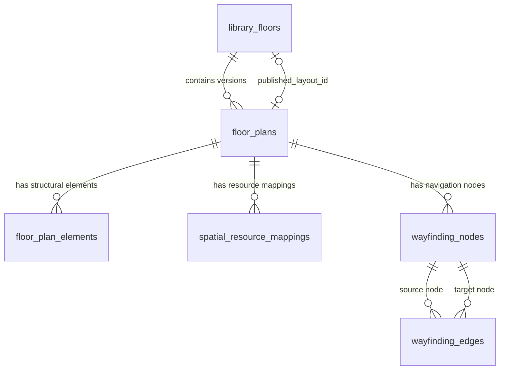

# Stage 10.5 — Interactive Library Floor Plans, Spatial Resource Mapping & Wayfinding Architecture

**Document Version:** 1.0.0  
**Phase:** Stage 10.5 Completion  
**Target Branch:** `feature/aryan-ai-library-system`  
**Classification:** Canonical Architecture & Implementation Documentation  

---

## 1. Executive Summary & Domain Scope

Stage 10.5 delivers a production-grade spatial subsystem for the AI-Powered Smart Library Management System, satisfying **SPAC-03 (Interactive Floor Plans)** while preserving all 34 canonical features (`PORT-01..06`, `DISC-01..05`, `CIRC-01..07`, `SPAC-01..05`, `INTEL-01..06`, `ADV-01..05`).

The subsystem provides:
1. **Spatial Data Models:** Normalized coordinate schema for multi-level buildings, visual floor layouts, architectural boundary elements, referential resource mappings, and wayfinding topological graphs.
2. **Referential Integrity & Boundary Enforcement:** Normalized coordinate boundaries $[0.0, 1.05]$, composite unique constraints preventing duplicate placement, and pre-publication validation requiring floor alignment.
3. **Batched Real-Time Availability Integration:** Zero N+1 query overhead; derives live reservation states (`available`, `reserved`, `occupied`, `unavailable`) for every mapped physical resource at the queried time without patron PII leakage.
4. **Wayfinding Path Engine:** Graph-based shortest path navigation (Dijkstra's algorithm with Euclidean heuristics) traversing wayfinding nodes and bidirectional edges, providing turn-by-turn guidance and dynamic distance metrics.
5. **Interactive React/TypeScript Canvas:** Vector SVG floor plan canvas with responsive zoom/pan controls, visual zone boundaries, study room footprints, color-coded seat markers, hover tooltips, and animated glowing route polylines.
6. **Librarian Spatial Studio:** Complete floor plan lifecycle manager supporting draft layout editing, pre-publication validation, element addition, and live completeness monitoring across all canonical study resources.
7. **Honest Demonstration Disclosure:** Transparent disclaimer `"ILLUSTRATIVE DEMONSTRATION LAYOUT — NOT A SURVEYED BUILDING PLAN"` surfaced consistently across UI views, API responses, and database seed metadata.

---

## 2. Spatial Data Architecture & Relational Schema

### 2.1 Database Entities & Relationships

The spatial subsystem introduces six core relational models on SQLAlchemy's declarative base:

1. **`LibraryFloor` (`library_floors`)**:
   - Primary key: `id` (Integer)
   - `floor_number`: Unique integer representing building elevation (e.g., `0` for Ground Floor, `1` for 1st Floor, `2` for 2nd Floor, `3` for 3rd Floor).
   - `name`, `description`: Human-readable labels.
   - `published_layout_id`: Foreign key pointing to `floor_plans.id` configured with `use_alter=True` to resolve circular dependency with `FloorPlan.floor_id`.
   - `canvas_width`, `canvas_height`: Reference dimensions (`1000.0 x 700.0`).
   - `is_active`: Operational toggle.

2. **`FloorPlan` (`floor_plans`)**:
   - Primary key: `id` (Integer)
   - `floor_id`: Foreign key to `library_floors.id`.
   - `version`: Monotonically increasing revision integer per floor.
   - `status`: String enum `('draft', 'published', 'archived')`.
   - `title`, `description`, `svg_viewbox` (`0 0 1000 700`), `is_active`.
   - Unique constraint: `uq_floor_plan_version (floor_id, version)`.

3. **`FloorPlanElement` (`floor_plan_elements`)**:
   - Architectural layout geometry for rendering walls, zones, desks, and amenities.
   - `element_type`: `'wall'`, `'door'`, `'zone_boundary'`, `'room_footprint'`, `'desk_group'`, `'stairs'`, `'elevator'`, `'restroom'`, `'service_desk'`, `'label'`.
   - Coordinates: Normalized floats `x`, `y`, `width`, `height`, `rotation`.
   - `svg_path`: Optional raw SVG path markup for complex polygon walls or custom curves.
   - `style_properties`: JSON blob containing fill, stroke, strokeWidth, opacity, and typography settings.

4. **`SpatialResourceMapping` (`spatial_resource_mappings`)**:
   - Associates physical database resources to normalized visual canvas positions.
   - `resource_type`: `'seat'`, `'study_room'`, `'study_zone'`, `'book_collection'`.
   - `resource_id`: Primary key of the referenced resource in `study_seats`, `study_rooms`, `study_zones`, etc.
   - Coordinates: Normalized floats `x`, `y`, `width`, `height`, `rotation`.
   - Unique constraint: `uq_spatial_resource_mapping (layout_id, resource_type, resource_id)` ensuring a resource cannot be mapped multiple times on a single layout.

5. **`WayfindingNode` (`wayfinding_nodes`)**:
   - Navigation graph vertex representing a decision point, entrance, stairwell, elevator, or resource approach point.
   - Coordinates: Normalized floats `x`, `y`.
   - Optional foreign keys: `resource_type` and `resource_id` for automated path destination binding.

6. **`WayfindingEdge` (`wayfinding_edges`)**:
   - Bidirectional navigation edge connecting `source_node_id` and `target_node_id`.
   - `weight`: Distance cost in normalized canvas units or physical meters.
   - `edge_type`: `'walkway'`, `'corridor'`, `'stairs'`, `'elevator'`, `'door'`.
   - `is_accessible`: ADA accessibility flag for wheelchair-friendly path filtering.

---

## 3. Normalized Coordinate System & Bounds

All visual coordinates ($x, y, \text{width}, \text{height}$) are normalized to standard proportional floats:
$$0.0 \le x \le 1.05, \quad 0.0 \le y \le 1.05$$

### Coordinate Projection Matrix:
When rendered onto the SVG canvas or responsive viewport:
$$\text{Pixel } X = x \times \text{canvas\_width}$$
$$\text{Pixel } Y = y \times \text{canvas\_height}$$

This decouples layout geometry from device display resolution, ensuring identical fidelity on high-DPI desktop displays, mobile viewports, and university kiosk displays.

---

## 4. Referential Integrity & Publication Validation

Before any draft `FloorPlan` can be published via `POST /api/spaces/layouts/{id}/publish`, `SpatialService.validate_layout()` enforces strict validation invariants:
1. **Floor Alignment Invariant:** All mapped resources must belong to the same floor as the floor plan. If a seat in Zone 1 (Floor 1) is placed on a Floor 2 layout, publication fails with `HTTP 400 Bad Request`.
2. **Active Resource Existence:** Every `resource_id` must reference an active, non-archived record in the respective catalog table.
3. **Graph Connectivity:** All wayfinding edges must reference valid nodes belonging to the layout.
4. **Coordinate Boundaries:** Every element and resource mapping must fall within $[0.0, 1.05]$.

Once published, the floor's `published_layout_id` is updated, and existing published layouts on that floor transition to `'archived'`.

---

## 5. Privacy-Preserving Real-Time Availability Engine

To maintain high performance and prevent patron PII leakage:
1. **Batched Availability Retrieval:** When a floor plan is retrieved via `GET /api/spaces/floors/{id}`, the backend executes a single batched query against `study_reservations` for the requested time window $[t, t+1\text{ hour}]$.
2. **Status Derivation:**
   - Resource has checked-in reservation: `'occupied'` (red marker `#ef4444`).
   - Resource has confirmed reservation awaiting check-in: `'reserved'` (amber marker `#f59e0b`).
   - Resource is active with zero overlapping reservations: `'available'` (green marker `#22c55e`).
   - Resource is under maintenance or inactive: `'unavailable'` (slate marker `#94a3b8`).
3. **Strict Patron PII Exclusion:** Mapped resource payloads expose only resource code, type, capacity, amenities, zone information, and availability status. Fields such as `user_id`, `patron_email`, and `reservation_id` are strictly excluded from the spatial API response.

---

## 6. Wayfinding Engine (Dijkstra Navigation)

Wayfinding calculates the shortest navigable route from an origin (e.g. main entrance or user-selected starting node) to any study seat, room, or service desk:
- **Graph Algorithm:** Dijkstra shortest path with positive weights computed from Euclidean distance:
  $$w(u, v) = \sqrt{(x_u - x_v)^2 + (y_u - y_v)^2}$$
- **Turn-by-Turn Instruction Generator:** Calculates angle variations between sequential edge vectors $\vec{v}_1, \vec{v}_2$:
  $$\theta = \text{atan2}(v_{2y}, v_{2x}) - \text{atan2}(v_{1y}, v_{1x})$$
  Produces intuitive instructions: `"Proceed straight"`, `"Turn left"`, `"Turn right"`, `"Arrive at destination"`.
- **Accessible Path Routing:** Supports `accessible_only=true` query parameter, filtering out edges marked with `stairs` in favor of elevators and ramps.

---

## 7. Interactive Frontend Architecture

The frontend integrates spatial capabilities into both patron and staff portals:
1. **`FloorPlanCanvas.tsx`**:
   - Interactive SVG canvas rendering architectural elements, zone boundaries, room labels, and color-coded seat markers.
   - Smooth mouse wheel / touch zoom and drag pan controls with reset button.
   - Animated SVG polyline for active wayfinding routes (`strokeDasharray` animation).
   - Rich hover tooltips displaying real-time availability, power outlet availability, and capacity.
2. **`StudentFloorPlan.tsx`**:
   - Floor switcher tabs across Ground, 1st, 2nd, and 3rd floors.
   - Dual-view mode: Interactive SVG Map vs Accessible Tabular List.
   - Resource search and multi-criteria filters (Resource Type, Zone, Live Availability).
   - Side inspector drawer displaying selected resource details, "Get Directions" trigger, and "Book This Space" direct routing to the reservation workflow.
3. **`LibrarianFloorPlanManager.tsx`**:
   - Real-time spatial completeness metrics (100% mapped indicator for all 8 zones, 150 seats, 10 rooms).
   - Layout version history and status indicators (`draft`, `published`, `archived`).
   - Structural element creator for adding walls, doors, desks, and labels.
   - One-click publication validation and activation workflow.

---

## 8. Synthetic Spatial Demonstration Dataset

The demonstration seeder (`backend/app/seed_data/spatial_seed.py`) populates complete spatial layouts across all 4 university library floors:

| Floor Level | Floor Name | Mapped Zones | Mapped Study Rooms | Mapped Seats | Wayfinding Nodes & Edges |
| :--- | :--- | :--- | :--- | :--- | :--- |
| **Floor 0** | Ground Floor | Zone 1 (Silent Study), Zone 2 (Group Collab) | Room 101, Room 102 | 30 Seats (S-01 to S-30) | 8 Nodes, 14 Edges |
| **Floor 1** | First Floor | Zone 3 (Quiet Study), Zone 4 (Tech Lab) | Room 201, Room 202, Room 203 | 40 Seats (S-31 to S-70) | 9 Nodes, 16 Edges |
| **Floor 2** | Second Floor | Zone 5 (Research Commons), Zone 6 (Postgrad) | Room 301, Room 302, Room 303 | 40 Seats (S-71 to S-110) | 9 Nodes, 16 Edges |
| **Floor 3** | Third Floor | Zone 7 (Deep Focus), Zone 8 (Individual Pods) | Room 401, Room 402 | 40 Seats (S-111 to S-150) | 8 Nodes, 14 Edges |
| **Total** | **4 Floors** | **8 Zones (100%)** | **10 Rooms (100%)** | **150 Seats (100%)** | **34 Nodes, 60 Edges** |

Every layout element and response includes the transparent disclaimer:
`"ILLUSTRATIVE DEMONSTRATION LAYOUT — NOT A SURVEYED BUILDING PLAN"`

---

## 9. Verification & Invariant Proof

- **Backend Test Suite:** `backend/tests/test_spatial.py` contains 11 dedicated automated tests verifying floor management, layout publication, coordinate validation, floor alignment enforcement, real-time availability calculation, privacy protection, Dijkstra routing, and completeness metrics.
- **Full Backend Regression:** 321 passing tests, 2 skipped, 0 failures across the entire test suite.
- **Database Safety Guardrails:** All 4 protected database hashes match baseline digests; `backend/.library_demo.lock` remains intact; Alembic head revision remains locked at `e5f6a7b8c9d0`.
- **Frontend Production Build:** `tsc -b && vite build` compiled 133 modules cleanly with 0 TypeScript errors.

